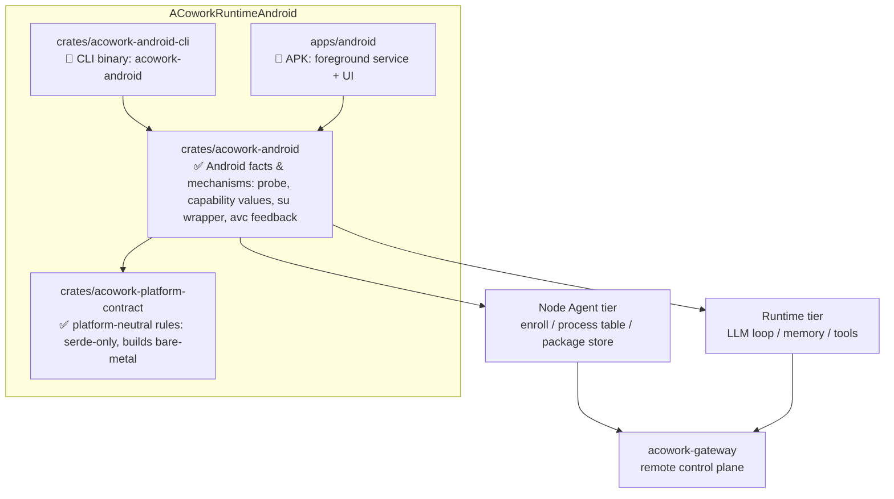

<h1 align="center">ACoworkRuntimeAndroid</h1>

<p align="center">
  <strong>Android / Termux ports of <code>acowork-runtime</code> and <code>acowork-node</code></strong><br>
  <em>A CLI build for the command line, and an APK build that lives inside an app.</em>
</p>

<p align="center">
  <a href="./LICENSE"></a>
  <a href="https://www.rust-lang.org"></a>
  
</p>

<p align="center">
  <a href="README.zh.md">简体中文</a>
</p>

---

> **Status: early development.** The design docs are in place, and two crates ship as buildable, tested
> Rust libraries: the platform-neutral contract layer (`acowork-platform-contract`) and the Android host
> layer (`acowork-android`, the P0 slice — HostProfile probe, script assembly, process spawn and
> `ExecutionBackend` implementations, the §4.4 read-tier guardrail, the §4.5 tool
> descriptions, the §4.6.1 audit outlet, the measured evidence surface and the §4.6.4 rollback ledger). 550 tests pass, the contract layer also builds for a bare-metal RISC-V
> target, and the chain has been run against a physical device — a Huawei BLA-AL00 over adb:
> 20 read-only probes → `HostProfile` → real commands, exit 0 in ~120 ms, including `logcat`,
> which only works because the probe spot-checks for it. **No node binary exists yet** (the
> runnable thing today is that device harness), and nothing here is ready for production use.
>
> ⚠️ **Partially synced with [README.zh.md](README.zh.md).** The repository layout, roadmap, and build
> sections below were brought in line on 2026-10-29. The Chinese version remains authoritative for the
> prose sections (the two deliverables, host profiles) and for the APK deliverable's unresolved
> form-factor overlap with upstream `apps/acowork-mobile`. **All `docs/` are Chinese-only** — start with
> the [readiness assessment](docs/review/zh/2026-10-28-readiness-assessment.md) for what conflicts with
> upstream, and [ADR-AND-002](docs/adr/zh/ADR-AND-002-platform-contract-layer.md) for the multi-platform
> contract layer. Everything below marked 🚧 or *planned* is a design intent, not shipped code.

---

## What is this?

[ACowork](https://github.com/acowork/ACowork) is a multi-user, distributed AI agent collaboration
platform. Its topology is a flat three-tier design:

| Tier | Component | Role |
|------|-----------|------|
| **Gateway** | `acowork-gateway` | One control plane per cluster — HTTP on `:19876`, embedded MQTT broker on `:19875`, reverse proxy to every Node / Runtime, package manager, intent router. |
| **Node Agent** | `acowork-node` | One per host that runs Runtimes — process table (spawn / kill / reap), local package store, MQTT enrollment, local reverse proxy on `:19900`. |
| **Runtime** | `acowork-runtime` | One per running `.agent` instance — the LLM loop, memory, tools, and a per-agent HTTP server on loopback. |

ACowork today runs on desktop platforms (Windows / macOS / Linux). **This repository brings the Node
Agent and Runtime tiers to Android** — so a phone, a tablet, or a rooted device can host agents,
enroll with an existing Gateway, and act as a first-class member of the cluster rather than a
thin client.

## Two deliverables

The Android port ships as two binaries from the same core, sharing one library crate:

### 1. CLI build — `acowork-android` (terminal / Termux)

The command-line version, run inside Termux or any Android terminal environment.

```bash
# placeholder — the subcommand surface is not finalized yet
acowork-android serve --gateway-http http://<gateway-host>:19876
```

- Same CLI ergonomics as the desktop `acowork-node`: enroll with a Gateway, start / stop agents, browse files, install packages.
- Runs under a normal unprivileged user — no root required for the base feature set.
- On a rooted debug device it can opt into the `root-shell` host profile (see below) for system-level
  development and debugging. This is a **mode of the same binary**, not a third build.
- Intended for power users, headless devices, CI-on-device, and scripted automation.

### 2. APK build — `acowork-android-app`

The same capabilities packaged as an Android application.

- A foreground service that keeps the Node Agent alive under Android's background execution limits.
- MQTT enrollment and reconnect handling driven by Android's connectivity / battery callbacks.
- Workspace and package storage mapped to scoped app-private directories, with optional user-granted access to shared storage.
- Intended for everyday use: an always-on agent host that a Gateway can reach over the network.

Both builds share the same agent engine — the difference is **lifecycle management** (Termux process vs.
foreground service) and **storage / permission strategy**, not the runtime semantics.

## Host profiles

The engine runs on three kinds of Android host. Which one you get is **probed at startup**, not configured
by hand: the same binary behaves differently on a stock phone and on a rooted engineering device.

| Capability | `apk-sandbox` | `termux` | `root-shell` (debug devices) |
|---|:---:|:---:|:---:|
| Shell execution | ❌ | ✅ `bash` | ✅ `/system/bin/sh` (mksh) + toybox / busybox |
| File reach | app-private dirs | `$PREFIX` + user-granted SAF | `/data` at large; `/system` only after remount |
| Other apps' data (`/data/data/*`) | ❌ | ❌ | ✅ where SELinux allows |
| Full `logcat` | ❌ | own app only | ✅ |
| `setprop` / `am` / `pm` / `input` / `screencap` | ❌ | ❌ | ✅ |
| Risk | low | medium | **high — can brick the device** |

Two rules hold across all three profiles:

- **The Runtime itself never runs as root.** It holds Gateway credentials and an LLM API key, serves HTTP
  on loopback, and executes instructions arriving over the network. Escalation happens **per tool call**,
  inside a narrow execution backend, so that one prompt injection cannot own the whole device — and so
  that files written by the agent stay readable by the next, unprivileged start.
- **`root` is not a boolean.** It is decomposed into approvable capabilities (`android:shell:read`,
  `android:shell:write`, `android:fs:outside-app`, `android:fs:system`, `android:selinux:permissive`),
  each gated by the existing session approval mechanism, each audited. Destructive operations
  (`dd` to a block device, `wipe data`, partition flashes) are refused by default.

Note that root alone is not the interesting constraint on Android — **the SELinux domain is**. A uid-0
process is still confined by policy, `/system` is still verity-protected and read-only on user builds,
and `/system/bin/sh` is mksh, not bash. The probe measures all of this rather than assuming it.

Design rationale: [ADR-AND-001](docs/adr/zh/ADR-AND-001-android-host-profiles-and-execution-backend.md) ·
Probe specification: [android-host-probe.md](docs/design/zh/android-host-probe.md)


## Why a separate repository?

The upstream Rust workspace targets desktop hosts and assumes a POSIX-ish process model and a local
filesystem. Android breaks several of those assumptions:

- **No stable foreground process.** Android will kill background processes; long-lived agents need a
  foreground service with an ongoing notification.
- **Storage is scoped.** `/sdcard` is not a normal working directory; working dirs need SAF / app-private
  directories and permission grants.
- **No shell by default.** Tool execution cannot assume `bash`, and process spawning must account for
  Android's process model.
- **Different target triple and NDK toolchain.** Cross-compilation, JNI, and `.so` packaging need their
  own build pipeline.
- **Battery and doze.** Idle agents get suspended; keep-alive behavior has to be designed, not assumed.

Keeping the port in its own repository lets the upstream desktop workspace stay clean, lets this
project iterate on an Android-specific toolchain, and keeps the Android release cadence independent of
the desktop one. **The goal is a clean upstreaming path** — platform-specific code should stay behind
traits, so that once the port is stable, the differences can be reconciled with minimal churn upstream.

## Repository layout

The two crates under `crates/` **exist and build**; `crates/acowork-android-cli` and `apps/android` are
still 🚧 *planned*.



| Path | Contents |
|------|----------|
| `crates/acowork-platform-contract/` | **The platform-neutral rules**: the four capability axes, the evidence discipline behind a claim, the execution envelope, the authorization gate, the feedback primitives. Depends on `serde` alone and builds under `no_std + alloc`. Any platform joining the cluster — Android, ESP32, whatever comes next — must satisfy R1–R13 as stated here. See [ADR-AND-002](docs/adr/zh/ADR-AND-002-platform-contract-layer.md) (Chinese). |
| `crates/acowork-android/` | **Android's facts and mechanisms**: which commands to probe, how to parse them, the four-axis values for the five `android:*` capabilities, the `su -c` wrapper, `avc: denied` feedback. The test is: swap the platform and the contract crate does not change by one line, while this crate is rewritten entirely. |
| `crates/` (planned) | The remaining Rust crates shared by both builds — the Android-aware runtime + node engine. |
| `apps/` (planned) | The APK application (Gradle project, Kotlin/Java shell, foreground service). |
| `docs/` | Design notes, platform notes, and the porting rationale — see [ADR-AND-001](docs/adr/zh/ADR-AND-001-android-host-profiles-and-execution-backend.md) (host profiles & privilege model), [ADR-AND-002](docs/adr/zh/ADR-AND-002-platform-contract-layer.md) (the platform contract layer), [android-host-probe.md](docs/design/zh/android-host-probe.md) (startup capability probing), and the [readiness assessment](docs/review/zh/2026-10-28-readiness-assessment.md) (conflicts with upstream). All Chinese. |

### Android is only the first port

ACowork's goal is **multi-platform node access**: after Android come ESP32-class devices. Those platforms
share **no execution model** — an ESP32 has no processes, no POSIX filesystem, no MMU, no SELinux, no
`std`, and possibly no atomic instructions. So there is no unified *implementation* available, but there
can be unified *rules*. That is exactly the split above, and it is why the conformance suite
[`tests/rules_conformance.rs`](crates/acowork-android/tests/rules_conformance.rs) — not the Android code
itself — is the artifact a second port should copy.

## Relationship to upstream

- Upstream: [acowork/ACowork](https://github.com/acowork/ACowork) — the desktop platform. This repository is
  a **port of two of its tiers**, not a fork of the whole product. Gateway, PM, and Doc remain upstream.
- License is identical: Apache-2.0, so code can flow in either direction.
- The protocol contract with the Gateway is unchanged — an Android Node Agent enrolls and is driven
  exactly like a desktop one. The Gateway does not need to know that the far side is a phone.

## Roadmap

🚧 *aspirational, in rough order.*

| # | Scope | Status |
|---|-------|--------|
| 1 | Repository skeleton, license, and this README | 🚧 In progress |
| 2 | Shared crate: extract node + runtime engine behind platform traits | ⛔ **Blocked (B3)** — upstream design 30 §5 and §9 give two different answers on engine ownership. Note this blocks the *engine*; the *host rules* layer shipped independently as #5a and is unaffected by how B3 is ruled |
| 3 | CLI build running under Termux, enrolling with a real Gateway | ⬜ Planned (depends on #2) |
| 4 | APK build: foreground service, scoped storage, keep-alive | ⛔ **Blocked (B4)** — collides with upstream `apps/acowork-mobile` (Tauri v2 Android APK, design 25 / ADR-086): same form factor, opposite purpose, ownership unresolved |
| 5 | `ExecutionBackend` trait + startup HostProfile probe | ✅ **Delivered** (P0) — `crates/acowork-android/src/host/` |
| 5a | **Platform-neutral contract layer** `acowork-platform-contract`: rules R1–R13 plus a per-rule conformance suite (the template for ESP32-class ports) | ✅ **Delivered** — builds for a bare-metal target; see [ADR-AND-002](docs/adr/zh/ADR-AND-002-platform-contract-layer.md) |
| 5b | Execution stack: script assembly, the `SpawnRunner` seam, `ShellBackend` / `RootShellBackend` / `AppSandboxBackend`, and an adb transport | ✅ **Delivered and verified on hardware** — `cargo run --example device_probe` drives a real device end to end; reconciling its answers against the fixtures corrected five things the fixtures had invented (see [the ground-truth suite](crates/acowork-android/tests/device_ground_truth.rs)) |
| 6 | Battery / doze tuning and long-run stability testing | ⬜ Planned |
| 7 | Release artifacts (Termux package + signed APK) | ⬜ Planned (depends on #2/#4; the NDK pipeline can reuse upstream `apps/acowork-mobile`) |
| 5c | The **three outlets** of the §7.1 reporting boundary: capability summary / backend error text / a command's own stdout·stderr | ✅ **Delivered** — the third was found by measuring, not by thinking: 181 avc audit records from a single `logcat -d` were crossing the port verbatim, and the guard test asserted on the JSON of a `Vec<u8>`, which serde writes as an array of numbers, so **any content passed**. Audit records are now rewritten at the projection into permissions + object class + target type; user, role, MLS range and path stay on the device. Non-record lines such as a `ps -Z` row survive byte-for-byte |
| 8 | `root-shell` profile, **read-only capabilities** (`logcat` / `dumpsys` / `getprop`) | 🚧 **Mostly delivered** — the read tier is now enforced on script content, not on the caller's label ([`host/commands.rs`](crates/acowork-android/src/host/commands.rs)), and the commands it covers are probed rather than assumed (item 6c); verified end to end on a BLA-AL00. Remaining: `RootShellBackend` on a rooted device — it has never been run against a real `su` |
| 9 | Android debugging toolset (screencap, ANR / tombstone / bugreport capture) + command audit log | 🚧 **Half delivered** — the audit log is ([`host/audit.rs`](crates/acowork-android/src/host/audit.rs)): `AuditedBackend` writes an `attempted` record before the device is touched and a terminal one after, and a sink that cannot take the opening record stops the command. The evidence surface is measured (probe items 13 / 13b): on a `user` build with no root, **none** of the six sources ADR §4.6 item 6 commits to can yield `/data/anr` contents, and `dumpsys` is 246 services each with its own answer. **The capture actions are now delivered** ([`host/evidence.rs`](crates/acowork-android/src/host/evidence.rs)): `screencap -p`, `logcat -d`, `dumpsys <service>` and `bugreportz` come back as files in the Agent workspace, verified against a digest the device computed before the transfer — a 1 377 361-byte PNG in 6 reads and a 4 101 144-byte bugreport zip in 16, both measured on BLA-AL00. What is still planned is the *correlation* half (feeding artifacts to an analysis step), and `/data/anr` + `/data/tombstones` stay unreadable because the device says so, not because the port has not got to it |
| 10 | Write capabilities: approval gating, per-device write lock, prop / file auto-rollback | ⛔ **Blocked (B1)** — ADR §7.4's owner conjunct conflicts with upstream ADR-087 D1/D5; the gate is implemented per the two-authority decomposition and awaits upstream confirmation. **The rollback half is no longer part of the blocker**: §4.6.4 ships as `host/rollback.rs` (capture pre-state → inverse → LIFO restore) for **both** kinds of write; the decorator order lives in [`host/chain.rs`](crates/acowork-android/src/host/chain.rs) — rollback outside audit, so a capture and a restore are commands the log sees — property inverses and file snapshots, where the bytes travel as base64, live in the Agent's own workspace, are written back in 48 KiB chunks and must match the digest the device reported before the write (verified on hardware: a 61440-byte random file overwritten with 9 bytes and restored byte-for-byte). What still keeps the write tier closed is approval ownership and the device write lock, not the absence of an undo path |
| 11 | Magisk-module form factor for always-on debug fleets — **only if that need is real** | ⬜ Deferred |

Ordering is deliberate: **read-only before writable**. The read-only root profile already covers most
system-debugging value (logs, state, properties) with essentially no brick risk, while the write profile
is where every irreversible decision lives and gets isolated accordingly.

None of the three ⛔ items can be settled inside this repository — each is a conflict between a ruling
here and an authority upstream. The full reconciliation record, the architectural resolutions adopted, and
the five contract gaps found during implementation (B8–B12) are in the
[readiness assessment](docs/review/zh/2026-10-28-readiness-assessment.md) (Chinese).

## Building

### Host side (what builds today)

Both crates are plain Rust libraries with no platform-specific code, so they build and test on any host:

```bash
cargo build                                        # build
cargo test                                         # 550 tests (android unit 366 + contract 86 + contract integration 27 + rule conformance 43 + real-process 13 + device ground truth 15)
cargo clippy --all-targets -- -D warnings          # upstream CI convention; must be warning-free
cargo fmt --check
RUSTDOCFLAGS="-D warnings" cargo doc --no-deps      # every doc link must resolve
```

The rules layer must additionally pass on a **bare-metal target**. This is a hard gate on R12 (the
contract presumes no OS facility), not an optional check:

```bash
rustup target add riscv32imc-unknown-none-elf      # 32-bit RISC-V, no OS, and no atomic instructions
cargo build  -p acowork-platform-contract --no-default-features --target riscv32imc-unknown-none-elf
cargo clippy -p acowork-platform-contract --no-default-features --target riscv32imc-unknown-none-elf -- -D warnings
```

`imc` is chosen over the ESP32's actual `imac` precisely because it has *one facility fewer* — no `a`
extension, hence no atomics — making it the stricter test. The cost is that `ResourceLock` is compiled out
there via `target_has_atomic = "ptr"`; R11's semantics remain mandatory, but a single-core target without
atomics supplies exclusion from a critical section it already has. See
[ADR-AND-002](docs/adr/zh/ADR-AND-002-platform-contract-layer.md) §5.2.

### Against a real device

Every test above argues with a model of a device. `device_probe` argues with one:

```bash
ACOWORK_ADB=/path/to/adb ACOWORK_ADB_SERIAL=<serial> cargo run --example device_probe
```

It runs the 20 read-only probes over `adb shell`, assembles the `HostProfile`, builds the backend that
profile implies, and executes one real command through it. It needs no root and changes nothing on the
device beyond the `echo` it runs.

Its output is committed as `tests/fixtures/devices/huawei-bla-al00-api29.json` and reconciled field by
field by `tests/device_ground_truth.rs`. That reconciliation is not decoration: it is where the five
fabrications in roadmap #5b were found, because a fixture can only ever prove the parser agrees with
itself.

`--no-default-features` builds the crate without the adb transport (`device` feature), and the example
is gated off with it so the lean-build check stays meaningful.

Toolchain mirrors upstream `core/Cargo.toml`: edition 2024, rust-version 1.95, Apache-2.0.

**Dependency discipline**: `acowork-platform-contract` depends on `serde` alone
(`default-features = false` + `alloc`/`derive`) — not even `async-trait`, since async is spelled with
`core::future::Future` plus a GAT associated future type, unboxed. `acowork-android`'s only non-serde
dependency is the contract crate. Neither depends on `acowork-runtime` / `acowork-core`. This is a
*structural* guarantee rather than a convention; verify with
`cargo tree -p acowork-platform-contract --no-default-features -e features --edges no-dev` and confirm no
`serde_core feature "std"` edge in the lib graph (`--edges no-dev` matters — the `serde_json`
dev-dependency will otherwise mislead you).

### Android side (not started)

The cross-compilation, JNI, and `.so` packaging pipeline does not exist yet, so the exact NDK version and
target triple are not pinned.

**Do not build it from scratch**: upstream `apps/acowork-mobile` already has a working Tauri v2 Android
build (its `Cargo.toml` carries a `cfg(target_os = "android")` section and a `jni` dependency). Take its
NDK version, target triple, and packaging steps as the baseline and adjust. This is the "existing facts
left unused" item under B4 in the assessment.

## Contributing

This repository is young and its conventions are still forming. Please open an issue before sending a
large change, so we can agree on direction before the work is done.

## License

Apache-2.0 — see [LICENSE](./LICENSE).
