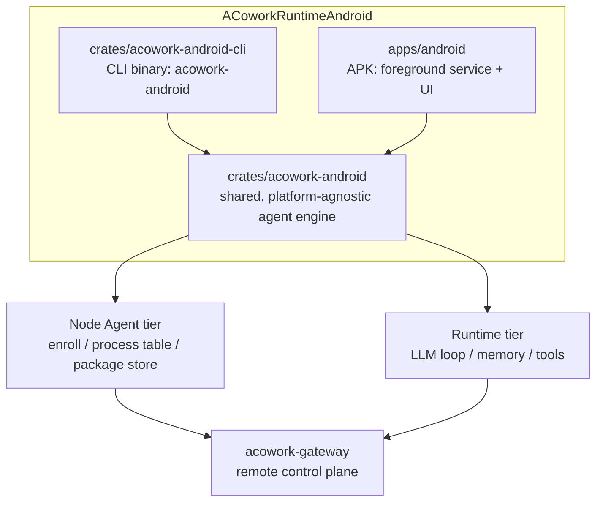

<h1 align="center">ACoworkRuntimeAndroid</h1>

<p align="center">
  <strong>Android / Termux ports of <code>acowork-runtime</code> and <code>acowork-node</code></strong><br>
  <em>A CLI build for the command line, and an APK build that lives inside an app.</em>
</p>

<p align="center">
  <a href="./LICENSE"></a>
  <a href="https://www.rust-lang.org"></a>
  
</p>

<p align="center">
  <a href="README.zh.md">简体中文</a>
</p>

---

> **Status: early development / initial skeleton.** This repository has just been created.
> Everything below marked 🚧 or *planned* is a design intent, not shipped code. No binary is
> released yet, and nothing here is ready for production use.

---

## What is this?

[ACowork](https://github.com/acowork/ACowork) is a multi-user, distributed AI agent collaboration
platform. Its topology is a flat three-tier design:

| Tier | Component | Role |
|------|-----------|------|
| **Gateway** | `acowork-gateway` | One control plane per cluster — HTTP on `:19876`, embedded MQTT broker on `:19875`, reverse proxy to every Node / Runtime, package manager, intent router. |
| **Node Agent** | `acowork-node` | One per host that runs Runtimes — process table (spawn / kill / reap), local package store, MQTT enrollment, local reverse proxy on `:19900`. |
| **Runtime** | `acowork-runtime` | One per running `.agent` instance — the LLM loop, memory, tools, and a per-agent HTTP server on loopback. |

ACowork today runs on desktop platforms (Windows / macOS / Linux). **This repository brings the Node
Agent and Runtime tiers to Android** — so a phone, a tablet, or a rooted device can host agents,
enroll with an existing Gateway, and act as a first-class member of the cluster rather than a
thin client.

## Two deliverables

The Android port ships as two binaries from the same core, sharing one library crate:

### 1. CLI build — `acowork-android` (terminal / Termux)

The command-line version, run inside Termux or any Android terminal environment.

```bash
# placeholder — the subcommand surface is not finalized yet
acowork-android serve --gateway-http http://<gateway-host>:19876
```

- Same CLI ergonomics as the desktop `acowork-node`: enroll with a Gateway, start / stop agents, browse files, install packages.
- Runs under a normal unprivileged user — no root required for the base feature set.
- On a rooted debug device it can opt into the `root-shell` host profile (see below) for system-level
  development and debugging. This is a **mode of the same binary**, not a third build.
- Intended for power users, headless devices, CI-on-device, and scripted automation.

### 2. APK build — `acowork-android-app`

The same capabilities packaged as an Android application.

- A foreground service that keeps the Node Agent alive under Android's background execution limits.
- MQTT enrollment and reconnect handling driven by Android's connectivity / battery callbacks.
- Workspace and package storage mapped to scoped app-private directories, with optional user-granted access to shared storage.
- Intended for everyday use: an always-on agent host that a Gateway can reach over the network.

Both builds share the same agent engine — the difference is **lifecycle management** (Termux process vs.
foreground service) and **storage / permission strategy**, not the runtime semantics.

## Host profiles

The engine runs on three kinds of Android host. Which one you get is **probed at startup**, not configured
by hand: the same binary behaves differently on a stock phone and on a rooted engineering device.

| Capability | `apk-sandbox` | `termux` | `root-shell` (debug devices) |
|---|:---:|:---:|:---:|
| Shell execution | ❌ | ✅ `bash` | ✅ `/system/bin/sh` (mksh) + toybox / busybox |
| File reach | app-private dirs | `$PREFIX` + user-granted SAF | `/data` at large; `/system` only after remount |
| Other apps' data (`/data/data/*`) | ❌ | ❌ | ✅ where SELinux allows |
| Full `logcat` | ❌ | own app only | ✅ |
| `setprop` / `am` / `pm` / `input` / `screencap` | ❌ | ❌ | ✅ |
| Risk | low | medium | **high — can brick the device** |

Two rules hold across all three profiles:

- **The Runtime itself never runs as root.** It holds Gateway credentials and an LLM API key, serves HTTP
  on loopback, and executes instructions arriving over the network. Escalation happens **per tool call**,
  inside a narrow execution backend, so that one prompt injection cannot own the whole device — and so
  that files written by the agent stay readable by the next, unprivileged start.
- **`root` is not a boolean.** It is decomposed into approvable capabilities (`android:shell:read`,
  `android:shell:write`, `android:fs:outside-app`, `android:fs:system`, `android:selinux:permissive`),
  each gated by the existing session approval mechanism, each audited. Destructive operations
  (`dd` to a block device, `wipe data`, partition flashes) are refused by default.

Note that root alone is not the interesting constraint on Android — **the SELinux domain is**. A uid-0
process is still confined by policy, `/system` is still verity-protected and read-only on user builds,
and `/system/bin/sh` is mksh, not bash. The probe measures all of this rather than assuming it.

Design rationale: [ADR-AND-001](docs/adr/zh/ADR-AND-001-android-host-profiles-and-execution-backend.md) ·
Probe specification: [android-host-probe.md](docs/design/zh/android-host-probe.md)


## Why a separate repository?

The upstream Rust workspace targets desktop hosts and assumes a POSIX-ish process model and a local
filesystem. Android breaks several of those assumptions:

- **No stable foreground process.** Android will kill background processes; long-lived agents need a
  foreground service with an ongoing notification.
- **Storage is scoped.** `/sdcard` is not a normal working directory; working dirs need SAF / app-private
  directories and permission grants.
- **No shell by default.** Tool execution cannot assume `bash`, and process spawning must account for
  Android's process model.
- **Different target triple and NDK toolchain.** Cross-compilation, JNI, and `.so` packaging need their
  own build pipeline.
- **Battery and doze.** Idle agents get suspended; keep-alive behavior has to be designed, not assumed.

Keeping the port in its own repository lets the upstream desktop workspace stay clean, lets this
project iterate on an Android-specific toolchain, and keeps the Android release cadence independent of
the desktop one. **The goal is a clean upstreaming path** — platform-specific code should stay behind
traits, so that once the port is stable, the differences can be reconciled with minimal churn upstream.

## Repository layout

🚧 *planned* — the structure below is the intended shape, not what exists today.



| Path | Contents |
|------|----------|
| `crates/` | Rust crates shared by both builds — the Android-aware runtime + node engine. |
| `apps/` | The APK application (Gradle project, Kotlin/Java shell, foreground service). |
| `docs/` | Design notes, platform notes, and the porting rationale — see [ADR-AND-001](docs/adr/zh/ADR-AND-001-android-host-profiles-and-execution-backend.md) (host profiles & privilege model) and [android-host-probe.md](docs/design/zh/android-host-probe.md) (startup capability probing). |

## Relationship to upstream

- Upstream: [acowork/ACowork](https://github.com/acowork/ACowork) — the desktop platform. This repository is
  a **port of two of its tiers**, not a fork of the whole product. Gateway, PM, and Doc remain upstream.
- License is identical: Apache-2.0, so code can flow in either direction.
- The protocol contract with the Gateway is unchanged — an Android Node Agent enrolls and is driven
  exactly like a desktop one. The Gateway does not need to know that the far side is a phone.

## Roadmap

🚧 *aspirational, in rough order.*

| # | Scope | Status |
|---|-------|--------|
| 1 | Repository skeleton, license, and this README | 🚧 In progress |
| 2 | Shared crate: extract node + runtime engine behind platform traits | ⬜ Planned |
| 3 | CLI build running under Termux, enrolling with a real Gateway | ⬜ Planned |
| 4 | APK build: foreground service, scoped storage, keep-alive | ⬜ Planned |
| 5 | `ExecutionBackend` trait + startup HostProfile probe | ⬜ Planned |
| 6 | Battery / doze tuning and long-run stability testing | ⬜ Planned |
| 7 | Release artifacts (Termux package + signed APK) | ⬜ Planned |
| 8 | `root-shell` profile, **read-only capabilities** (`logcat` / `dumpsys` / `getprop`) | ⬜ Planned |
| 9 | Android debugging toolset (screencap, ANR / tombstone / bugreport capture) + command audit log | ⬜ Planned |
| 10 | Write capabilities: approval gating, per-device write lock, prop / file auto-rollback | ⬜ Planned |
| 11 | Magisk-module form factor for always-on debug fleets — **only if that need is real** | ⬜ Deferred |

Ordering is deliberate: **read-only before writable**. The read-only root profile already covers most
system-debugging value (logs, state, properties) with essentially no brick risk, while the write profile
is where every irreversible decision lives and gets isolated accordingly.

## Building

Nothing builds yet. Once there is a first compilable crate, the build instructions will live here,
along with the exact NDK version and target triple.

## Contributing

This repository is young and its conventions are still forming. Please open an issue before sending a
large change, so we can agree on direction before the work is done.

## License

Apache-2.0 — see [LICENSE](./LICENSE).
