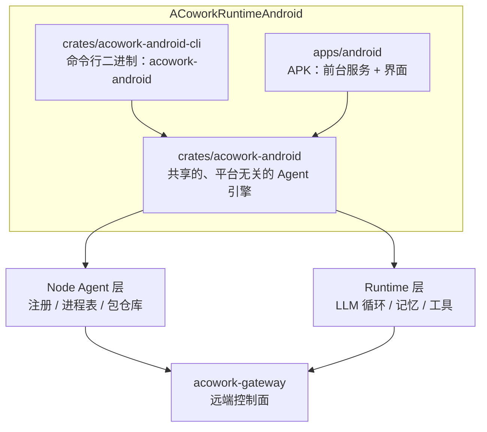

<h1 align="center">ACoworkRuntimeAndroid</h1>

<p align="center">
  <strong><code>acowork-runtime</code> 与 <code>acowork-node</code> 的 Android / Termux 移植版</strong><br>
  <em>一个跑在命令行下的命令行版本，一个跑在 APK 里的 App 版本。</em>
</p>

<p align="center">
  <a href="./LICENSE"></a>
  <a href="https://www.rust-lang.org"></a>
  
</p>

<p align="center">
  <a href="README.md">English</a>
</p>

---

> **状态：早期开发 / 初始化骨架。** 本仓库刚刚创建。下文标注 🚧 或「计划中」的内容均为设计意图，
> 并非已交付的代码。目前没有任何可用二进制产物，不适合用于生产环境。

---

## 这是什么？

[ACowork](https://github.com/acowork/ACowork) 是一个多用户、分布式的 AI Agent 协作平台，整体采用扁平的三层拓扑：

| 层级 | 组件 | 职责 |
|------|------|------|
| **Gateway** | `acowork-gateway` | 每个集群一个控制面 —— HTTP 在 `:19876`，内嵌 MQTT Broker 在 `:19875`，反向代理到各 Node / Runtime，包管理、意图路由。 |
| **Node Agent** | `acowork-node` | 每台承载 Runtime 的机器一个 —— 进程表（拉起 / 终止 / 回收）、本地包仓库、MQTT 注册、本地反向代理在 `:19900`。 |
| **Runtime** | `acowork-runtime` | 每个运行中的 `.agent` 实例一个 —— LLM 主循环、记忆、工具，以及每个 Agent 在回环地址上的 HTTP 服务。 |

ACowork 目前运行在桌面平台（Windows / macOS / Linux）上。**本仓库要把 Node Agent 与 Runtime 两层带到
Android 上** —— 让手机、平板或已 Root 的设备可以承载 Agent、注册到已有的 Gateway，从而成为集群中
一等公民的节点，而不是一个只能发请求的瘦客户端。

## 两个交付物

Android 移植版从同一份核心代码出发，产出两个二进制 / 产物，共享同一个 library crate：

### 1. 命令行版本 —— `acowork-android`（终端 / Termux）

运行在 Termux 或其他 Android 终端环境下的命令行版本。

```bash
# 占位示例 —— 子命令形态尚未定稿
acowork-android serve --gateway-http http://<gateway-host>:19876
```

- 与桌面端 `acowork-node` 一致的 CLI 使用体验：注册 Gateway、启动 / 停止 Agent、浏览文件、安装包。
- 以普通非特权用户身份运行，基础能力集不需要 Root。
- 在已 Root 的调试设备上，可启用 `root-shell` 宿主档（见下节）做系统级开发与调试。这是同一个二进制的
  **一种运行模式**，不是第三个产物。
- 面向高级用户、无屏设备、设备侧 CI 与脚本化自动化场景。

### 2. App 版本 —— `acowork-android-app`

同样能力的 Android 应用形态。

- 通过前台服务在 Android 后台执行限制下保持 Node Agent 存活。
- MQTT 注册与重连由 Android 的网络 / 电池回调驱动。
- 工作区与包存储映射到应用私有的受作用域目录，可按需申请共享存储访问权限。
- 面向日常使用：一个常在线、可被 Gateway 通过网络访问的 Agent 宿主。

两个版本共享同一套 Agent 引擎，差别在于**生命周期管理方式**（Termux 进程 vs. 前台服务）与
**存储 / 权限策略**，而非运行时语义本身。

## 宿主档（Host Profiles）

引擎可以运行在三种 Android 宿主上。具体落到哪一档，是**启动时探测**出来的，而不是手工配置的：同一个
二进制在一台原生手机上和在一台已 Root 的工程机上，表现并不相同。

| 能力 | `apk-sandbox` | `termux` | `root-shell`（调试设备） |
|---|:---:|:---:|:---:|
| shell 执行 | ❌ | ✅ `bash` | ✅ `/system/bin/sh`（mksh）+ toybox / busybox |
| 文件可达范围 | 应用私有目录 | `$PREFIX` + 用户授权的 SAF | `/data` 大范围；`/system` 仅在可 remount 后 |
| 跨应用数据（`/data/data/*`） | ❌ | ❌ | ✅（以 SELinux 允许为限） |
| 全量 `logcat` | ❌ | 仅本应用 | ✅ |
| `setprop` / `am` / `pm` / `input` / `screencap` | ❌ | ❌ | ✅ |
| 风险等级 | 低 | 中 | **高（可变砖）** |

三条宿主档共同遵守两条规则：

- **Runtime 自身绝不以 root 运行。** 它持有 Gateway 凭证与 LLM API key，在回环地址上提供 HTTP 服务，
  并执行来自网络侧的指令。提权只发生在**单次工具调用**内部、发生在窄接口的执行后端里 —— 于是一次提示
  注入不会丢掉整台设备；同时 Agent 写出的文件，下次以非特权身份启动时仍然读得到、删得掉。
- **`root` 不是一个布尔量。** 它被拆成可审批的 capability：`android:shell:read`、`android:shell:write`、
  `android:fs:outside-app`、`android:fs:system`、`android:selinux:permissive`，各自走既有的会话审批机制，
  各自留审计记录。破坏性操作（`dd` 写块设备、`wipe data`、刷分区）默认拒绝。

需要强调的是，Android 上真正起约束作用的并不是 root，而是 **SELinux 域**：uid 0 的进程依然受策略限制；
user 版上 `/system` 依然有 verity 保护且只读；`/system/bin/sh` 是 mksh 而不是 bash。探测机制测量的正是
这些事实，而不是假设它们。

设计取舍：[ADR-AND-001](docs/adr/zh/ADR-AND-001-android-host-profiles-and-execution-backend.md) ·
探测规格：[android-host-probe.md](docs/design/zh/android-host-probe.md)

## 为什么独立建仓？

上游 Rust workspace 面向桌面宿主机，假设了一个类 POSIX 的进程模型和本地文件系统。Android 打破了
其中若干假设：

- **没有稳定的前台进程。** Android 会回收后台进程；长驻 Agent 必须依赖带常驻通知的前台服务。
- **存储是受作用域限制的。** `/sdcard` 不是普通工作目录；工作目录需要使用 SAF / 应用私有目录，并依赖权限授予。
- **默认没有 shell。** 工具执行不能假设存在 `bash`，进程派生也要适配 Android 的进程模型。
- **目标三元组与 NDK 工具链不同。** 交叉编译、JNI 与 `.so` 打包都需要独立的构建流水线。
- **电池与 Doze 省电机制。** 空闲 Agent 会被挂起，保活行为必须显式设计，而不能默认成立。

独立建仓的好处：让上游桌面 workspace 保持干净；本项目可以按 Android 专属工具链独立迭代；Android
侧的发布节奏与桌面侧解耦。**最终目标是形成一条干净的上游回流路径** —— 平台相关代码应收敛在 trait 之后，
待移植稳定后，能够以较小的改动成本与上游对齐。

## 仓库结构

🚧 *规划中* —— 下面是预期形态，而非当前已存在的内容。



| 路径 | 内容 |
|------|------|
| `crates/` | 两个版本共用的 Rust crate —— 适配 Android 的 runtime + node 引擎。 |
| `apps/` | APK 应用（Gradle 工程，Kotlin/Java 外壳，前台服务）。 |
| `docs/` | 设计说明、平台笔记与移植取舍记录 —— 见 [ADR-AND-001](docs/adr/zh/ADR-AND-001-android-host-profiles-and-execution-backend.md)（宿主档与权限模型）与 [android-host-probe.md](docs/design/zh/android-host-probe.md)（启动能力探测）。 |

## 与上游的关系

- 上游：[acowork/ACowork](https://github.com/acowork/ACowork) —— 桌面平台。本仓库是**其中两层的移植**，
  而非整个产品的 fork。Gateway、PM、Doc 仍留在上游。
- License 一致：Apache-2.0，代码可以双向流动。
- 与 Gateway 的协议契约不变 —— Android 侧的 Node Agent 注册方式与被驱动方式，与桌面端完全一致，
  Gateway 无需感知对端是一台手机。

## 路线图

🚧 *愿景性规划，大致顺序。*

| # | 范围 | 状态 |
|---|------|------|
| 1 | 仓库骨架、许可证与本 README | 🚧 进行中 |
| 2 | 共享 crate：把 node + runtime 引擎抽取到平台 trait 之后 | ⬜ 计划中 |
| 3 | 命令行版本在 Termux 下运行，并注册到真实 Gateway | ⬜ 计划中 |
| 4 | App 版本：前台服务、受作用域存储、保活 | ⬜ 计划中 |
| 5 | `ExecutionBackend` trait + 启动时 HostProfile 能力探测 | ⬜ 计划中 |
| 6 | 电池 / Doze 调优与长跑稳定性测试 | ⬜ 计划中 |
| 7 | 发布产物（Termux 包 + 签名 APK） | ⬜ 计划中 |
| 8 | `root-shell` 宿主档，**仅只读能力**（`logcat` / `dumpsys` / `getprop`） | ⬜ 计划中 |
| 9 | Android 调试工具集（截屏、ANR / tombstone / bugreport 采集）+ 命令审计日志 | ⬜ 计划中 |
| 10 | 写能力档：审批门控、设备级写锁、prop / 文件自动回滚 | ⬜ 计划中 |
| 11 | Magisk 模块形态，用于长期挂机的调试设备农场 —— **仅当该需求真实成立** | ⬜ 暂缓 |

顺序是刻意安排的：**先只读，后可写**。只读的 root 档已经能覆盖绝大多数系统调试诉求（日志、状态、属性），
且几乎没有变砖风险；而写能力档集中了所有不可逆决策，因此被单独隔离到最后交付。

## 构建

目前尚无可构建内容。待出现第一个可编译的 crate 后，本节会补充构建说明，包括确切的 NDK 版本与
目标三元组。

## 参与贡献

本仓库较新，约定仍在形成中。提交较大改动前请先开 issue，以便在动手之前对齐方向。

## 许可证

Apache-2.0 —— 见 [LICENSE](./LICENSE)。
