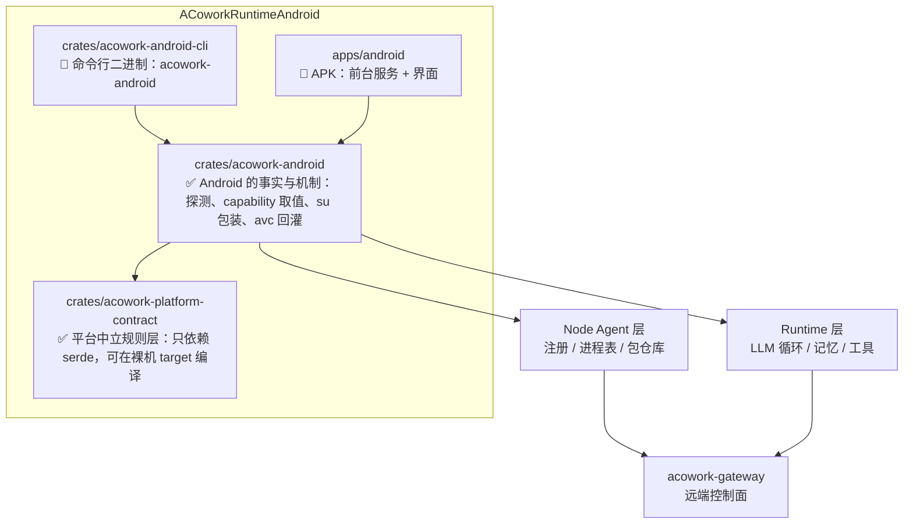

<h1 align="center">ACoworkRuntimeAndroid</h1>

<p align="center">
  <strong><code>acowork-runtime</code> 与 <code>acowork-node</code> 的 Android / Termux 移植版</strong><br>
  <em>一个跑在命令行下的命令行版本，一个跑在 APK 里的 App 版本。</em>
</p>

<p align="center">
  <a href="./LICENSE"></a>
  <a href="https://www.rust-lang.org"></a>
  
</p>

<p align="center">
  <a href="README.md">English</a>
</p>

---

> **状态：早期开发。** 设计文档齐备，P0 切片（HostProfile 探测、脚本装配、进程生成、
> `ExecutionBackend` 实现、§4.4 只读档护栏、§4.5 动态工具描述、§4.6.1 审计日志出口、§4.6 item 6 证据面实测、§4.6.4 写操作可撤销）已交付为可构建、可测试的 Rust 库，539 个测试通过，
> 且整条链路已在真机上跑通过（华为 BLA-AL00，经 adb：20 条只读探测 → `HostProfile` → 真实命令，
> ~120ms / exit 0，其中 `logcat` 之所以能跑，是因为探测项 6c 去抽查了它）。
> **仍无 node 二进制产物**——目前唯一可运行的东西就是那个真机 harness——不适合用于生产环境。
>
> 下文标注 🚧 / ⬜ / ⛔ 的内容均为设计意图。三条 ⛔ 是「本仓库裁定 vs 上游权威」的冲突，
> 需上游或产品裁定，详见[开发就绪度评估](docs/review/zh/2026-10-28-readiness-assessment.md)。

---

## 这是什么？

[ACowork](https://github.com/acowork/ACowork) 是一个多用户、分布式的 AI Agent 协作平台，整体采用扁平的三层拓扑：

| 层级 | 组件 | 职责 |
|------|------|------|
| **Gateway** | `acowork-gateway` | 每个集群一个控制面 —— HTTP 在 `:19876`，内嵌 MQTT Broker 在 `:19875`，反向代理到各 Node / Runtime，包管理、意图路由。 |
| **Node Agent** | `acowork-node` | 每台承载 Runtime 的机器一个 —— 进程表（拉起 / 终止 / 回收）、本地包仓库、MQTT 注册、本地反向代理在 `:19900`。 |
| **Runtime** | `acowork-runtime` | 每个运行中的 `.agent` 实例一个 —— LLM 主循环、记忆、工具，以及每个 Agent 在回环地址上的 HTTP 服务。 |

ACowork 目前运行在桌面平台（Windows / macOS / Linux）上。**本仓库要把 Node Agent 与 Runtime 两层带到
Android 上** —— 让手机、平板或已 Root 的设备可以承载 Agent、注册到已有的 Gateway，从而成为集群中
一等公民的节点，而不是一个只能发请求的瘦客户端。

## 两个交付物

Android 移植版从同一份核心代码出发，产出两个二进制 / 产物，共享同一个 library crate：

### 1. 命令行版本 —— `acowork-android`（终端 / Termux）

运行在 Termux 或其他 Android 终端环境下的命令行版本。

```bash
# 占位示例 —— 子命令形态尚未定稿
acowork-android serve --gateway-http http://<gateway-host>:19876
```

- 与桌面端 `acowork-node` 一致的 CLI 使用体验：注册 Gateway、启动 / 停止 Agent、浏览文件、安装包。
- 以普通非特权用户身份运行，基础能力集不需要 Root。
- 在已 Root 的调试设备上，可启用 `root-shell` 宿主档（见下节）做系统级开发与调试。这是同一个二进制的
  **一种运行模式**，不是第三个产物。
- 面向高级用户、无屏设备、设备侧 CI 与脚本化自动化场景。

### 2. App 版本 —— `acowork-android-app`

同样能力的 Android 应用形态。

- 通过前台服务在 Android 后台执行限制下保持 Node Agent 存活。
- MQTT 注册与重连由 Android 的网络 / 电池回调驱动。
- 工作区与包存储映射到应用私有的受作用域目录，可按需申请共享存储访问权限。
- 面向日常使用：一个常在线、可被 Gateway 通过网络访问的 Agent 宿主。

> ⛔ **形态归属未裁定（评估 B4）。** 上游已有 Android APK：`apps/acowork-mobile`
> （Tauri v2，design 25 v1.3「工程开发中」/ ADR-086），但定位**相反**——它是「IM 形态的对话控制终端」，
> 明确「❌ 无本地 Gateway 进程」「❌ Agent 管理不做」，且刻意不带 `acowork-core` / `rumqttc` 依赖；
> 而本交付物是承载 Node Agent 的**节点宿主**。
>
> 未回答的问题：用户装两个 APK，还是 mobile 长出 host mode？包名 / 签名 / 前台服务 / 电池白名单如何共存？
> 在该问题裁定前不应开工。可复用的是它的 **NDK 构建管线**（见「构建」一节）。

两个版本共享同一套 Agent 引擎，差别在于**生命周期管理方式**（Termux 进程 vs. 前台服务）与
**存储 / 权限策略**，而非运行时语义本身。

## 宿主档（Host Profiles）

引擎可以运行在三种 Android 宿主上。具体落到哪一档，是**启动时探测**出来的，而不是手工配置的：同一个
二进制在一台原生手机上和在一台已 Root 的工程机上，表现并不相同。

| 能力 | `apk-sandbox` | `termux` | `root-shell`（调试设备） |
|---|:---:|:---:|:---:|
| shell 执行 | ❌ | ✅ `bash` | ✅ `/system/bin/sh`（mksh）+ toybox / busybox |
| 文件可达范围 | 应用私有目录 | `$PREFIX` + 用户授权的 SAF | `/data` 大范围；`/system` 仅在可 remount 后 |
| 跨应用数据（`/data/data/*`） | ❌ | ❌ | ✅（以 SELinux 允许为限） |
| 全量 `logcat` | ❌ | 仅本应用 | ✅ |
| `setprop` / `am` / `pm` / `input` / `screencap` | ❌ | ❌ | ✅ |
| 风险等级 | 低 | 中 | **高（可变砖）** |

三条宿主档共同遵守两条规则：

- **Runtime 自身绝不以 root 运行。** 它持有 Gateway 凭证与 LLM API key，在回环地址上提供 HTTP 服务，
  并执行来自网络侧的指令。提权只发生在**单次工具调用**内部、发生在窄接口的执行后端里 —— 于是一次提示
  注入不会丢掉整台设备；同时 Agent 写出的文件，下次以非特权身份启动时仍然读得到、删得掉。
- **`root` 不是一个布尔量。** 它被拆成可审批的 capability：`android:shell:read`、`android:shell:write`、
  `android:fs:outside-app`、`android:fs:system`、`android:selinux:permissive`，各自走既有的会话审批机制，
  各自留审计记录。破坏性操作（`dd` 写块设备、`wipe data`、刷分区）默认拒绝。

需要强调的是，Android 上真正起约束作用的并不是 root，而是 **SELinux 域**：uid 0 的进程依然受策略限制；
user 版上 `/system` 依然有 verity 保护且只读；`/system/bin/sh` 是 mksh 而不是 bash。探测机制测量的正是
这些事实，而不是假设它们。

设计取舍：[ADR-AND-001](docs/adr/zh/ADR-AND-001-android-host-profiles-and-execution-backend.md) ·
探测规格：[android-host-probe.md](docs/design/zh/android-host-probe.md)

## 为什么独立建仓？

上游 Rust workspace 面向桌面宿主机，假设了一个类 POSIX 的进程模型和本地文件系统。Android 打破了
其中若干假设：

- **没有稳定的前台进程。** Android 会回收后台进程；长驻 Agent 必须依赖带常驻通知的前台服务。
- **存储是受作用域限制的。** `/sdcard` 不是普通工作目录；工作目录需要使用 SAF / 应用私有目录，并依赖权限授予。
- **默认没有 shell。** 工具执行不能假设存在 `bash`，进程派生也要适配 Android 的进程模型。
- **目标三元组与 NDK 工具链不同。** 交叉编译、JNI 与 `.so` 打包都需要独立的构建流水线。
- **电池与 Doze 省电机制。** 空闲 Agent 会被挂起，保活行为必须显式设计，而不能默认成立。

独立建仓的好处：让上游桌面 workspace 保持干净；本项目可以按 Android 专属工具链独立迭代；Android
侧的发布节奏与桌面侧解耦。**最终目标是形成一条干净的上游回流路径** —— 平台相关代码应收敛在 trait 之后，
待移植稳定后，能够以较小的改动成本与上游对齐。

### 但 Android 只是第一个端口

ACowork 的目标是**多平台 node 接入**：Android 之后还有 ESP32 一类的嵌入式设备。这些平台之间
**没有统一的执行模型**——ESP32 没有进程、没有 POSIX 文件系统、没有 MMU、没有 SELinux、没有 `std`，
甚至可能没有原子指令。所以不存在「统一实现」，但可以存在**统一规则**。

这就是 `crates/acowork-platform-contract` 的职责：它固定任何 node 都必须满足的十三条规则（R1–R13），
只依赖 `serde`，可在裸机 target 上编译。Android 层则只负责**这台设备实测是什么、命令怎么跑**。
判据是一句话：换一个平台，契约层一行不改，Android 层全部重写。

Android「打样」的交付物因此不只是能跑的代码，而是
[`tests/rules_conformance.rs`](crates/acowork-android/tests/rules_conformance.rs)——逐条证明 R1–R13
的测试套件。第二个端口复制这个文件、保留规则名、替换 fixture 即可；某条规则在该平台不适用时要
**显式说明**而非删除，让「缺席」成为有记录的决定。详见
[ADR-AND-002](docs/adr/zh/ADR-AND-002-platform-contract-layer.md)。

## 仓库结构

`crates/` 下两个库**已存在并可构建可测试**；`crates/acowork-android-cli` 与 `apps/android` 仍是 🚧 *规划中*。



| 路径 | 内容 |
|------|------|
| `crates/acowork-platform-contract/` | **平台中立的规则层**：能力四轴、探测证据纪律、执行信封、授权闸门、反馈原语。只依赖 `serde`，`no_std + alloc` 可编译。任何平台（Android、ESP32、后续端口）挂进集群都要满足这里的 R1–R13。见 [ADR-AND-002](docs/adr/zh/ADR-AND-002-platform-contract-layer.md)。 |
| `crates/acowork-android/` | **Android 的事实与机制**：探测哪些命令、输出怎么解析、五个 `android:*` 能力的四轴取值、`su -c` 包装、`avc: denied` 回灌。判据是「换一个平台，契约层一行不改，这里全部重写」。 |
| `crates/`（规划） | 两个版本共用的其余 Rust crate —— 适配 Android 的 runtime + node 引擎。 |
| `apps/`（规划） | APK 应用（Gradle 工程，Kotlin/Java 外壳，前台服务）。 |
| `docs/` | 设计说明、平台笔记与移植取舍记录 —— 见 [ADR-AND-001](docs/adr/zh/ADR-AND-001-android-host-profiles-and-execution-backend.md)（宿主档与权限模型）、[ADR-AND-002](docs/adr/zh/ADR-AND-002-platform-contract-layer.md)（平台契约层）、[android-host-probe.md](docs/design/zh/android-host-probe.md)（启动能力探测）与 [开发就绪度评估](docs/review/zh/2026-10-28-readiness-assessment.md)（与上游的冲突核对）。 |

## 与上游的关系

- 上游：[acowork/ACowork](https://github.com/acowork/ACowork) —— 桌面平台。本仓库是**其中两层的移植**，
  而非整个产品的 fork。Gateway、PM、Doc 仍留在上游。
- License 一致：Apache-2.0，代码可以双向流动。
- 与 Gateway 的协议契约不变 —— Android 侧的 Node Agent 注册方式与被驱动方式，与桌面端完全一致，
  Gateway 无需感知对端是一台手机。

## 路线图

🚧 *愿景性规划，大致顺序。*

| # | 范围 | 状态 |
|---|------|------|
| 1 | 仓库骨架、许可证与本 README | 🚧 进行中 |
| 2 | 共享 crate：把 node + runtime 引擎抽取到平台 trait 之后 | ⛔ **阻塞（B3）** —— 上游 design 30 §5 与 §9 对「Android 引擎是编进 `acowork-runtime` 的 crate，还是依赖已发布 Host crate 的独立引擎」给出两种答案，且后者依赖的契约 crate 尚不存在。⚠️ 注意本项阻塞的是**引擎**归属；**宿主规则层**已按 #5a 独立交付，不受 B3 裁定影响 |
| 3 | 命令行版本在 Termux 下运行，并注册到真实 Gateway | ⬜ 计划中（依赖 #2） |
| 4 | App 版本：前台服务、受作用域存储、保活 | ⛔ **阻塞（B4）** —— 与上游 `apps/acowork-mobile`（Tauri v2 Android APK，design 25 / ADR-086）形态撞车而定位相反，归属未裁定 |
| 5 | `ExecutionBackend` trait + 启动时 HostProfile 能力探测 | ✅ **已交付**（P0）—— `crates/acowork-android/src/host/` |
| 5a | **平台中立契约层** `acowork-platform-contract`：R1–R13 规则 + 逐条一致性测试（为 ESP32 等后续端口打样） | ✅ **已交付** —— 裸机 target 编译通过，见 [ADR-AND-002](docs/adr/zh/ADR-AND-002-platform-contract-layer.md) |
| 5b | 执行栈：脚本装配、`SpawnRunner` 平台接缝、`ShellBackend` / `RootShellBackend` / `AppSandboxBackend`、adb 传输层 | ✅ **已交付并在真机上验证** —— `cargo run --example device_probe` 端到端驱动真机；把它的回包与 fixture 逐字段对账后，修正了 5 处 fixture 编造出来的事实（见[地面实况测试](crates/acowork-android/tests/device_ground_truth.rs)） |
| 6 | 电池 / Doze 调优与长跑稳定性测试 | ⬜ 计划中 |
| 7 | 发布产物（Termux 包 + 签名 APK） | ⬜ 计划中（依赖 #2/#4；NDK 管线可复用上游 `apps/acowork-mobile`） |
| 5c | §7.1 上报边界的**三个出口**：能力摘要 / 后端错误文案 / 命令自己的 stdout·stderr | ✅ **已交付** —— 第三个出口是量出来的而不是想出来的：`logcat -d` 的 181 条 avc 审计记录原本原样过线，而守门测试对 `Vec<u8>` 的 JSON 序列化做子串断言，**任何内容都能通过**。现在审计记录在投影处重写成「权限集 + 对象类 + 目标类型」，user / role / MLS 区间与路径留在设备上；`ps -Z` 这类非记录行逐字节不动 |
| 8 | `root-shell` 宿主档，**仅只读能力**（`logcat` / `dumpsys` / `getprop`） | 🚧 **大部分交付** —— 只读档现在按**脚本内容**放行而非按调用方标签（[`host/commands.rs`](crates/acowork-android/src/host/commands.rs)），且覆盖的命令是被探测出来的而非假定的（探测项 6c）；已在 BLA-AL00 上端到端验证。剩余：`RootShellBackend` 在一台真有 `su` 的设备上跑一次——它至今没碰过真实的 su |
| 9 | Android 调试工具集（截屏、ANR / tombstone / bugreport 采集）+ 命令审计日志 | 🚧 **交付一半** —— 审计日志已交付（[`host/audit.rs`](crates/acowork-android/src/host/audit.rs)）：`AuditedBackend` 在碰设备**之前**落一条 `attempted`、出结果后落收尾记录；开口记录写不进去就**不执行命令**。证据面已实测（探测项 13 / 13b）：无 root 时 ADR §4.6 item 6 那六个源**没有一个能取到 `/data/anr` 的内容**，`dumpsys` 那边是 246 个服务各自一项。**采集动作现已交付**（[`host/evidence.rs`](crates/acowork-android/src/host/evidence.rs)）：`screencap -p`、`logcat -d`、`dumpsys <service>`、`bugreportz` 都能作为文件落进 Agent 工作区，并用**设备在传输前自己算出的 digest** 验收——BLA-AL00 实测 1 377 361 字节的 PNG 走 6 次读、4 101 144 字节的 bugreport zip 走 16 次读。仍未做的是**关联分析**那一半（把产物交给分析步骤）；`/data/anr` 与 `/data/tombstones` 依旧读不到，那是设备说的，不是端口没写到 |
| 10 | 写能力档：审批门控、设备级写锁、prop / 文件自动回滚 | ⛔ **阻塞（B1）** —— ADR §7.4 的 owner 合取项与上游 ADR-087 D1/D5 冲突；门控骨架已按「两权威分解」实现，待上游确认。**回滚已不在阻塞项里**：§4.6.4 已落地为 [`host/rollback.rs`](crates/acowork-android/src/host/rollback.rs)（捕获前态 → 逆操作 → LIFO 恢复），装饰器顺序收在 [`host/chain.rs`](crates/acowork-android/src/host/chain.rs) 里——回滚在审计**外层**，捕获与恢复因此都是日志里看得见的命令；**两类写都有**——属性逆操作与文件快照：字节以 base64 离机、存进 Agent 自己的工作区、按 48 KiB 分片回写，且必须与设备在写之前自报的 digest 一致（真机验证：61440 字节随机文件被 9 字节覆盖后两片回写，逐字节还原）。写档剩下的阻塞是审批归属与设备级写锁，不是「没有撤销路径」 |
| 11 | Magisk 模块形态，用于长期挂机的调试设备农场 —— **仅当该需求真实成立** | ⬜ 暂缓 |

顺序是刻意安排的：**先只读，后可写**。只读的 root 档已经能覆盖绝大多数系统调试诉求（日志、状态、属性），
且几乎没有变砖风险；而写能力档集中了所有不可逆决策，因此被单独隔离到最后交付。

三条 ⛔ 都不是本仓库内部能自决的，而是「本仓库裁定 vs 上游权威」的冲突。完整核对记录、已采用的架构解法、
以及实现期新发现的 5 处契约缺口（B8–B12）见
[开发就绪度评估](docs/review/zh/2026-10-28-readiness-assessment.md)。

## 构建

### 宿主侧（当前可构建的部分）

两个 crate 都是纯 Rust 库，不含平台相关代码，可在任意宿主上构建与测试：

```bash
cargo build                                        # 构建
cargo test                                         # 539 个测试（Android 单元 355 + 契约层 86 + 契约集成 27 + 规则一致性 43 + 真进程 13 + 真机地面实况 15）
cargo clippy --all-targets -- -D warnings          # 上游 CI 约定，须零告警
cargo fmt --check
RUSTDOCFLAGS="-D warnings" cargo doc --no-deps      # 文档链接必须都能解析
```

规则层还要在**裸机 target** 上过一遍——这是 R12（契约不预设任何 OS 设施）的硬门，不是可选检查：

```bash
rustup target add riscv32imc-unknown-none-elf      # 32 位 RISC-V，无 OS，且无原子指令
cargo build  -p acowork-platform-contract --no-default-features --target riscv32imc-unknown-none-elf
cargo clippy -p acowork-platform-contract --no-default-features --target riscv32imc-unknown-none-elf -- -D warnings
```

选 `imc` 而非 ESP32 实际的 `imac`，是因为它**少一项设施**（无 `a` 扩展 → 无原子指令），因而是更严格的检验。代价是 `ResourceLock` 在该 target 上按 `target_has_atomic = "ptr"` 条件编译掉——R11 的语义仍是强制的，只是无原子的单核目标由端口自带临界区。详见 [ADR-AND-002](docs/adr/zh/ADR-AND-002-platform-contract-layer.md) §5.2。

### 接真机跑

上面的测试都在跟「设备的模型」讲道理；`device_probe` 跟设备本身讲：

```bash
ACOWORK_ADB=/path/to/adb ACOWORK_ADB_SERIAL=<serial> cargo run --example device_probe
```

它经 `adb shell` 跑完 20 条只读探测，装配出 `HostProfile`，按该 profile 构建对应后端，再通过它执行
一条真实命令。不需要 root，除它自己 `echo` 的那一下之外不改动设备上任何东西。

它的输出被固化为 `tests/fixtures/devices/huawei-bla-al00-api29.json`，由
`tests/device_ground_truth.rs` 逐字段对账。这个对账不是装饰——路线图 #5b 里那 5 处编造就是它找出来的：
fixture 永远只能证明解析器与自己自洽，证明不了它对上了任何一台真机。

`--no-default-features` 会构建出不含 adb 传输层的精简版本（`device` feature），example 也一并被门掉，
这样「精简构建」这项检查仍然有意义。


工具链对齐上游 `core/Cargo.toml`：edition 2024、rust-version 1.95、license Apache-2.0。

**依赖纪律**：`acowork-platform-contract` 只依赖 `serde`（`default-features = false` + `alloc`/`derive`），连 `async-trait` 都不用——异步靠 `core::future::Future` + GAT 关联 future 类型，不装箱。`acowork-android` 的唯一非 serde 依赖就是契约层。二者都**刻意不依赖** `acowork-runtime` / `acowork-core`：上游 design 30 §9 自己指出「`ExecutionBackend` 在引擎内部，EIP 在引擎外部」，二者正交；保持零引擎依赖使本仓库在 B3 的两种裁定下同时成立。这现在是**结构保证**而非约定——可用 `cargo tree -p acowork-platform-contract --no-default-features -e features --edges no-dev` 复核 lib 依赖图里没有 `serde_core feature "std"` 边（必须带 `--edges no-dev`，否则 dev-dependency `serde_json` 会误导）。

### Android 侧（尚未开始）

交叉编译、JNI 与 `.so` 打包的管线还没有建立，因此确切的 NDK 版本与目标三元组尚未固定。

**不要从零搭**：上游 `apps/acowork-mobile` 已经跑通 Tauri v2 的 Android 构建（其 `Cargo.toml`
含 `cfg(target_os = "android")` 段与 `jni` 依赖），NDK 版本、target triple 与打包步骤应先以它为基准，
再按本仓库需要调整。这是评估 B4 里「已有事实未被复用」的那一条。

## 参与贡献

本仓库较新，约定仍在形成中。提交较大改动前请先开 issue，以便在动手之前对齐方向。

## 许可证

Apache-2.0 —— 见 [LICENSE](./LICENSE)。
