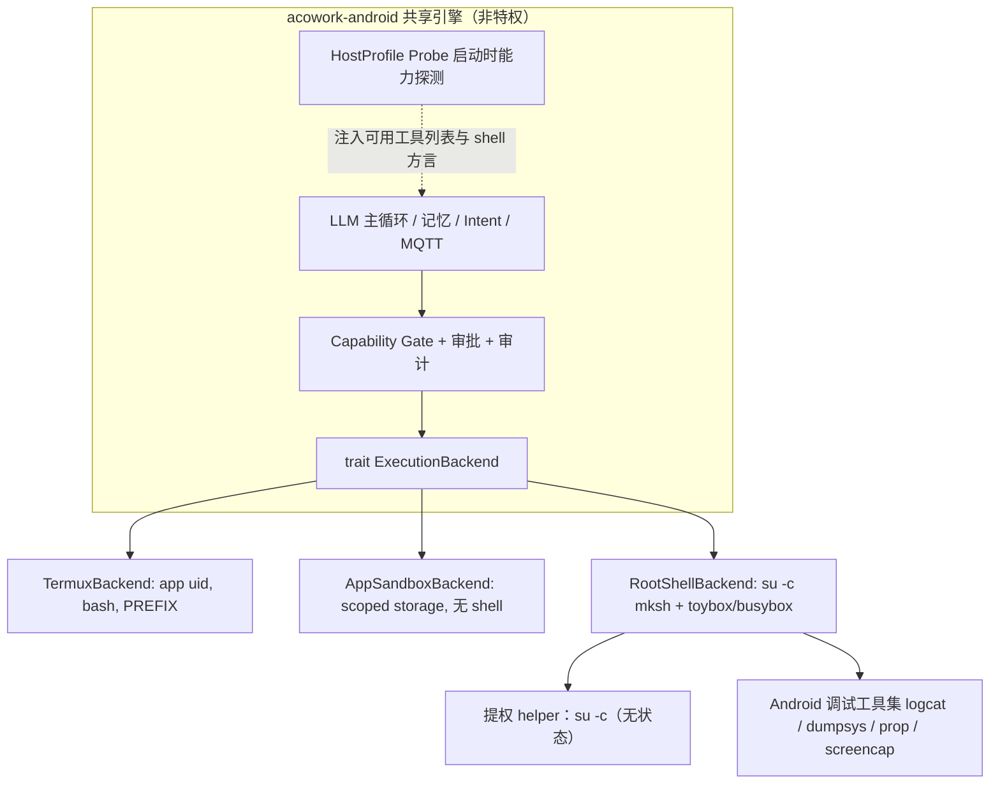

# ADR-AND-001: Android Host Profiles 与 ExecutionBackend（含高权限调试档）

- **状态**：**部分 Accepted** —— §1–§6（三档宿主、一个引擎、工具级提权、`ExecutionBackend` 契约）有效并已落地 P0；⚠️ **§7.1 与 §7.4 待与上游对齐**，二者被晚于本 ADR 的上游文档推翻，详见下方「上游冲突」与 [开发就绪度评估](../../review/zh/2026-10-28-readiness-assessment.md) B1/B2。
- **日期**：2026-10-20（原标 `2026-05-15` 有误：正文引用了 2026-09-13 才创建的 ADR-075、2026-10-05 的 ADR-087、2026-10-09 的 ADR-090，该日期不可能成立）
- **相关**：[README.md](../../../README.md)、上游 `docs/design/zh/12-tool-system.md`（平台支持矩阵与运行时平台检测）、上游 `core/acowork-runtime/src/tools/builtin/shell.rs`（多 shell 注册范式）、上游 ADR-087（node/agent 归属与门控）、上游 `docs/design/zh/30-runtime-protocol-and-pluggable-engine.md`（能力注册表与可插拔引擎，**v0.2 直接点名本 ADR**）、session 参数 `shellApprovalThreshold` / `approvalTimeoutSecs`
- **实现**：P0 已交付 —— `crates/acowork-android/src/host/`（探测解析器、capability 推导、`ExecutionBackend` 契约、门控、`avc` 回灌），115 测试通过，clippy `-D warnings` 零告警
- **EN mirror**：待补 `docs/adr/en/`（上游 `AGENTS.md:142` 要求中英 ADR 同一 commit 更新；本仓库尚未采用该约定，见评估 B7）

> ### ⚠️ 上游冲突（2026-10-28 核对）
>
> 本 ADR 提交于 2026-10-20。此后上游有两份文档修订，均与本 ADR 冲突：
>
> | 上游 | 日期 | 冲突点 |
> |---|---|---|
> | design 30 v0.2 §6.2 / §9 | 2026-10-24 | 「新增能力的唯一路径是注册表 PR」「能力是布尔开关，不带参数」；并明确要求本 ADR §7.1 的能力上报「**应改为**同一份能力注册表的一个来源」 |
> | ADR-087 v3 D1/D5 | 2026-10-28 | 「执行点 = Gateway 反代入口，Runtime 不引入 owner 概念」「owner 不进 MQTT proto，Node 不感知用户」——与本 ADR §7.4「设备本地判定请求者是 node owner」及 §7.1「Gateway 不做门控判定」不能同时成立 |
>
> **已采用的解法**（见评估 B1/B2）：把 §7.4 的合取项拆成两个权威——Gateway 判*归属*（下发不透明布尔裁决，设备看不到 owner 身份，满足 ADR-087 D1/D5），设备判*本地就绪*（`dangerous-mode` ∧ 写锁 ∧ 探测事实），最终合取在设备侧的 `authorize` 完成。capability 则保留为本仓库自己的领域类型，不绑定上游 `Permission` 封闭 enum；到最终注册表的映射层待 B2 裁定后再建，因此裁定倒向任一边都只需改一个文件。
>
> 影响面：**仅 P3 写档**。P0/P1/P2 只读档不触及 owner 门控，不受阻塞。

---

## 1. 背景与问题

本仓库当前设计以 **Termux** 作为 CLI 版本的 shell 宿主：安全性与兼容性好，但权限低，Agent 只能操作
应用自身目录（`$PREFIX` / app 私有目录）。

存在第二类场景：**调试用的 Android 设备**（eng / userdebug 版本，已 Root，带 busybox 或 toybox）。
这类场景需要读取全量 logcat、dumpsys、跨应用数据目录、setprop、am/pm/input/screencap，甚至修改系统分区。

要回答的问题：

> 能否用「真实 Android 命令行环境 + busybox」做一个高权限的 Android Runtime，用于 Android 系统开发调试？

### 1.1 必须先纠正的三个技术前提

| 常见假设 | 实际情况 | 对设计的影响 |
|---|---|---|
| Root = 全能 | Android 上真正的门槛是 **SELinux 域**，不是 uid。`adb shell` 位于 `shell` 域；`su` 后进入 Magisk 注入的 `u:r:magisk:s0` / `u:r:su:s0` 域；**root 进程仍受策略约束**，`avc: denied` 照旧出现 | 提权能力必须**探测**（`getenforce`、`/proc/self/attr/current`），不能假设「有 su 就全通」；`setenforce 0` 需作为独立高危能力单独审批 |
| `/system` 可写 | user 版只读 + dm-verity / AVB；`mount -o remount,rw /system` 需先 `disable-verity` 并重启；A/B 与动态分区使「改系统」退化为刷 image 级操作 | 「写系统分区」必须是显式能力 + 显式前置检查 + 显式回滚路径，不能由模型自由试探 |
| busybox ≈ 标准 Linux | `/system/bin/sh` 是 **mksh**（POSIX 子集，与 bash 语法存在差异）；Android 6+ 自带 **toybox**，与 busybox applet 参数不兼容（`sed -i`、`find -printf`、`stat -c` 等语义不同） | 不能伪装「一个 shell 通吃」。需注册为**两个独立工具**，各自带方言说明，交由模型选择 |

---

## 2. 约束与目标

**功能目标**

- F1：在 Root 设备上，Agent 可执行真实 Android 命令行（mksh + toybox/busybox）与系统级调试命令。
- F2：在普通设备上，行为与现有 Termux 方案完全一致，零回归。
- F3：同一份引擎代码同时支撑两种宿主，不产生第二套 Runtime 语义。

**非功能目标**

- N1（安全）：提权范围可声明、可审批、可审计；默认最小权限。
- N2（可回滚）：任何设备级变更都有明确恢复路径；不可逆操作默认拒绝。
- N3（可运维）：诊断信息（uid / SELinux 域 / verity 状态 / 拒绝原因）随错误一并返回。
- N4（契约稳定）：与 Gateway 的协议契约不变，Gateway 不感知宿主档位。

**显式非目标**

- 不做「把整个 Runtime 跑在 root 下」的形态（理由见 §4.1）。
- 不在本阶段引入 Magisk 模块打包管线。
- 不引入通用「插件式 shell 框架」——只解决三个已知宿主档。

---

## 3. 备选方案

### 方案 A：Termux 宿主 + `su -c` 提权 helper（**推荐**）

Runtime 仍以非特权身份跑在 Termux 内；仅 `shell` / 文件写入工具通过 `su -c` 无状态提权执行。

- ✅ 改动最小：只新增一个 `ExecutionBackend` 实现。
- ✅ 复用 Termux 现成的网络 / DNS / 包管理 / wake-lock 栈。
- ✅ 攻击面收敛：常驻网络进程不持有 root；root 只存在于单条命令的生命周期内。
- ✅ 文件属主不被污染（只有子命令是 root，Runtime 自身写出的文件仍是 app uid）。
- ⚠️ Magisk 授权弹窗可能反复出现（需会话级授权 + 常驻 daemon 兜底，见 §7）。
- ⚠️ 依赖设备上已装 Termux。

### 方案 B：独立静态二进制，`adb shell su -c` 拉起整个 Runtime

- ✅ 不依赖 Termux；权限最完整（进程级 magisk 域）。
- ❌ adb 会话断开即进程退出，保活需自行解决（`nohup` / init service），与 Android 生命周期无集成。
- ❌ 常驻进程持有 root + Gateway 凭证 + LLM key + loopback HTTP 服务：一次 prompt injection = 整机沦陷。
- ❌ root 写出的 config / log / workspace 属主为 uid 0，下次非特权启动读不到、删不掉。
- ❌ 需自建交叉编译与 `.so` 分发管线。

### 方案 C：Magisk 模块（init service + magisk 域常驻）

- ✅ 保活最强，适合长期挂机的设备农场。
- ❌ 新增模块打包 / 签名 / OTA 兼容 / 多 Magisk 变体（MagiskSU、KernelSU、SuperSU）适配成本。
- ❌ 与方案 B 同样的进程级 root 攻击面问题。

### 方案 D：不做高权限档，调试场景交给 adb + 人工

- ✅ 零成本。
- ❌ 放弃本场景的全部价值：无法闭环「复现 + 证据采集 + 关联分析」，Agent 在调试场景退化为聊天工具。

### 对比

| 维度 | A | B | C | D |
|---|---|---|---|---|
| 改动量 | 小 | 中 | 大 | 无 |
| 保活 | 复用 Termux | 差 | 强 | — |
| 攻击面 | 命令级 | 进程级 | 进程级 | 无 |
| 属主污染风险 | 低 | 高 | 高 | — |
| 调试场景价值 | 高 | 高 | 高 | 低 |

---

## 4. 决策

### 4.1 核心决策：三种 Host Profile，一个引擎，工具级提权

**Termux / APK 沙箱 / Root-Shell 是同一 Runtime 的三种宿主能力档（Host Profile），差别只在执行后端与权限边界，不在引擎语义。** 不新增第三个二进制，不新增第三个 crate，README 的「两个交付物」结构保持不变——Root 档是 CLI 版本的**一种运行模式**。

同时确立一条不可妥协的安全原则：**Runtime 主体保持非特权，只有工具执行下沉到提权 helper。**

理由：

1. Runtime 持有 Gateway enrollment 凭证与 LLM API key，在 loopback 上开 HTTP 服务，并直接执行来自远端的指令。整体 root 化后，提示注入的爆炸半径从「Agent 工作区」扩大到「整机 + 系统分区」。
2. 权限范围越大，越难界定「本次会话到底改了什么」。提权只发生在工具调用瞬间，审计边界才清晰。
3. 上游契约要求「Gateway 不感知对端是手机」，变的应当只是 capability 集合。

### 4.2 架构



依赖方向：三个 backend 实现依赖 `ExecutionBackend` 契约；引擎不依赖任何具体 backend。
这与上游「接口优先的依赖方向」以及 README 中「平台相关代码收敛在 trait 之后，保留干净的上游回流路径」一致。

### 4.3 能力矩阵

| 能力 | apk-sandbox | termux（现状） | root-shell（新增） |
|---|:---:|:---:|:---:|
| shell 执行 | ❌ | ✅ bash | ✅ mksh + toybox/busybox |
| 文件范围 | app 私有目录 | `$PREFIX` + 用户授权 SAF | `/data` 全域；`/system` 需 remount |
| 跨 app 数据（`/data/data/*`） | ❌ | ❌ | ✅（SELinux 允许时） |
| logcat 全量 | ❌ | 仅本 app | ✅ |
| setprop / am / pm / input / screencap | ❌ | ❌ | ✅ |
| 绕过 Doze | ❌（FGS 受限） | 依赖 Termux wake-lock | ✅（需显式策略与审批） |
| 风险等级 | 低 | 中 | **高（可 brick）** |

### 4.4 权限模型：把 root 拆成可审批的 capability

禁止 `root: true` 这类布尔量。沿用上游 `filesystem:read:<path>` 的粒度风格，新增：

| Capability | 覆盖范围 | 默认 |
|---|---|---|
| `android:shell:read` | getprop / dumpsys / logcat / ps / df / mount / getenforce | 白名单自动放行 |
| `android:shell:write` | setprop / am start / pm install / settings put / input | **需审批** |
| `android:fs:outside-app` | 写 `/data` 下非自身路径 | 需审批 + 自动备份 |
| `android:fs:system` | remount、写系统分区 | 需 dangerous-mode 会话开关 + 逐条审批 |
| `android:selinux:permissive` | `setenforce 0` | 逐条审批，会话结束自动恢复 |

审批机制**复用** session 已有的 `shellApprovalThreshold` / `approvalTimeoutSecs`，不新造一套审批子系统。

### 4.5 工具注册：复用上游双 shell 范式

上游 `shell.rs` 在 Windows 上已把 Git Bash 与 PowerShell 注册为**两个独立工具、各自带描述**，让模型有依据地选择并 fallback。Android 直接沿用：

- `bash`：Termux 环境，POSIX + bash 扩展。
- `ash`：`/system/bin/sh`（mksh），显式声明「无 bash 数组、`[[` 语义差异、命令由 toybox/busybox 提供」。

工具描述由 HostProfile Probe 的探测结果动态生成（哪些 applet 真实存在），而非硬编码。

### 4.6 调试场景护栏（rollback-first）

1. **审计日志**：每条提权命令记录 `capability / 实际 uid / SELinux 域 / 命令 / exit code / 耗时 / avc 拒绝`。
2. **拒绝归类**：从 stderr 抽取 `avc: denied`，转成可执行的下一步提示（「需要 su 域」/「需要显式 permissive 审批」），避免模型盲目重试。
3. **硬禁列表**：`dd of=/dev/block/*`、`rm -rf /data`、`wipe data`、`fastboot`、分区 `flash` —— 默认拒绝，即使 dangerous-mode 也需人工确认 + 设备指纹匹配。
4. **写操作可撤销**：改 prop 前记录旧值，会话结束自动回滚（`persist.*` 需显式声明才保留）；改文件先备份到 Agent 工作区，提供 `restore`。
5. **DeviceWriteLock**：root 操作作用于**整机全局状态**，多个 Agent 并发调试会互相踩踏。Node Agent 侧新增 per-device 写锁，串行化 mutating 命令（read 类不锁）。锁由 **session 持有**、TTL 10 分钟、拿不到锁立即失败不排队 —— 语义详见 §7.2。这是本决策引入的**新架构件**。
6. **证据采集**：`logcat -d`（带 buffer / filter）、`screencap`、`dumpsys <service>`、`/data/anr`、`/data/tombstones`、`bugreportz`。这是 root 档的真正价值——把「复现 → 证据 → 关联分析」闭环。

### 4.7 提权 helper 契约（窄接口）

```text
exec {
  script,             // 经 stdin 传入，禁止放入 argv（ps 可见，会泄露敏感参数）
  cwd, env, timeout,
  capability,         // 声明所需能力，用于门控与审计
  approval_token,
} -> {
  stdout, stderr, exit_code,
  selinux_denials[],  // 从 stderr 结构化抽取
  uid, context,       // 实际执行上下文，用于自证
  duration_ms,
}
```

起步为**无状态 `su -c`**（每次约 50–100ms 开销）。仅当实测证明开销或弹窗骚扰成为问题时，再引入常驻 daemon（loopback unix socket + token），遵循 rule-of-three。

---

## 5. 后果

**正面**

- 高权限调试场景成立，且 Termux 方案零回归。
- 引擎仍是一份，上游回流路径清晰：新增的是 trait 实现与 capability 声明，不是新分支逻辑。
- 权限从「布尔 root」变成可审计的 capability 集合，安全性优于「整体 root 化」的直觉方案。

**负面 / 需承担**

- 引入 HostProfile Probe 这一新组件，必须保证探测结果与实际执行一致（探测通过但执行被 SELinux 拒绝是常态，需明确降级语义）。
- DeviceWriteLock 是跨 Agent 的全局资源，其归属门控与上游 ADR-087 的叠加方式已在 §7.4 定案（双条件与、默认拒绝），实现时不可各自解释。
- Magisk 授权 UX 无法由我们控制（弹窗、会话时长由 Magisk 决定），需在文档中明确告知用户。
- 支持面扩大：toybox / busybox / 各 Root 方案的行为差异会持续产生兼容性 bug。

---

## 6. 验证与交付顺序

**先只读、后可写**——只读档已能覆盖 logcat / dumpsys / 属性查看等绝大多数系统调试诉求，且几乎无 brick 风险。

| 阶段 | 范围 | 验证方式 |
|---|---|---|
| P0 | `ExecutionBackend` trait + HostProfile Probe | 单元测试用伪造 probe 输出；真机三档（user / userdebug+root / Termux）快照对比 |
| P1 | `RootShellBackend` 只读档（`android:shell:read`） | 真机跑通 getprop / dumpsys / logcat；断言无 root 进程常驻 |
| P2 | Android 调试工具集 + 审计日志 | 结构化日志可复现每条命令的 capability 与上下文 |
| P3 | 写档 + 审批 + DeviceWriteLock + 自动回滚 | 故障注入：会话中断后 prop 回滚生效；并发双 Agent 争锁不互相污染 |
| P4 | Magisk 模块形态（**仅当**设备农场需求成立） | 暂缓，YAGNI |

**回滚路径**：`RootShellBackend` 是独立可选实现，未启用时引擎行为与现状完全一致；出问题可通过配置直接退回 Termux 档，无需回退代码。

---

## 7. 遗留问题裁定

以下四条在评审前是开放问题，现全部定案（含被否掉的选项与理由）。

### 7.1 HostProfile 是否上报 Gateway → **上报能力摘要，不上报设备细节**

> ⚠️ **本节两处裁定已被上游推翻，待对齐**（评估 B1/B2）：
> ①「Gateway 不做门控判定」与上游 ADR-087 D5「执行点 = Gateway 反代入口」冲突；
> ②「上报能力摘要」的词汇表所有权已归上游 design 30 §6.2 的能力注册表，该文档 §9 明确要求本节「**应改为**同一份能力注册表的一个来源」。
> 「上报什么 / 不上报什么」的隐私红线仍然有效并已落成测试（`gateway_summary_never_leaks_device_detail_on_any_tier`）。

- **上报**：`profile` 名 + `caps` 集合 + `shell dialect` + `privilege` 等级。
- **不上报**：设备序列号 / 型号、`fs_roots` 具体路径、SELinux context 原字符串、`observed-denials` 明细。
- **上报主体是 Node Agent，不是 Runtime**：宿主能力是**节点属性**，与具体 Agent 无关。放在 Node 侧上报，避免每个 Runtime 各自重复声明同一事实造成不一致（也与上游 ADR-075 node identity、ADR-090 安装归属「能力归 Node」的方向一致）。
- **Gateway 只用它做展示与筛选，不做门控判定**：真正的放行决策始终发生在设备本地。若 Gateway 也维护一份权限判断，就会出现两处权威、必然漂移。

> 否掉的选项：完全不上报。理由是 Gateway 无法区分「能调试的节点」与「普通手机节点」，调度与 UI 只能盲选，Agent 被派到不具备能力的节点上后才在运行期失败——错误暴露得越晚，排查成本越高。

### 7.2 DeviceWriteLock 持有者语义 → **由 session 持有，TTL 10 分钟，不排队不抢占**

| 决策点 | 裁定 |
|---|---|
| 持有者 | **session**，不是 agent |
| TTL | 10 分钟；每条 mutating 命令执行时自动续期 |
| 拿不到锁 | **立即返回明确错误**（含持有者标识），不阻塞、不排队 |
| 超时后 | 只释放，**不自动抢占** |
| 实现落点 | Node Agent 进程内单点串行，**不引入分布式锁** |

理由：

- **session 而非 agent**：调试是有始有终的会话活动，而 agent 是常驻实体。若由 agent 持有，一个崩溃或忘记释放的 agent 会让整机写能力永久不可用，且无法解释「为什么这个 agent 占着设备」。
- **不排队**：排队会制造一条隐蔽的串行队列，命令在队列里等待时模型看不到失败原因，只会重复提交（典型的静默降级反模式）。快速失败 + 明确持有者信息，才能让模型或人去做「换设备 / 联系持有者」的正确决策。
- **不抢占**：抢占会打断他人的写序列（prop 改了一半、文件备份了但没写完），产生比死锁更难恢复的中间状态。宁可拒绝服务，不可破坏一致性。
- **进程内单点**：一台设备一个 Node Agent，串行点天然存在，引入分布式锁是纯粹的过度设计。

### 7.3 dangerous-mode 是否需要 APK UI 开关 → **不做，首版仅 CLI flag**

- 形态：`--dangerous-mode` CLI flag + 环境变量兜底（供 CI 使用），**每次会话显式开启**，不做持久化配置。
- 理由：**APK 档根本没有 shell，也没有 su**，`android:fs:system` 在 APK 上不可达。给它做 UI 开关是为一条不存在的路径加配置项（YAGNI），还会误导用户以为勾上就能改系统。等 APK 侧真的出现提权路径时再议。

### 7.4 `android:fs:system` 与 ADR-087 owner 门控如何叠加 → **双条件与，默认拒绝**

> ⚠️ **本节按字面不可实现，已改为两权威分解**（评估 B1）：ADR-087 D1/D5 规定 owner 真相只存 Gateway、不进 MQTT proto、「Runtime 不引入 owner 概念」，因此设备本地无法评估「请求者是 node owner」这一合取项。
> **保留的**：双条件与、默认拒绝、无主设备一律不开放、fail-closed。
> **修订的**：归属条件由 Gateway 判定并下发**不透明布尔裁决**（`AttributionVerdict`，不含 user id / owner 名 / 角色），设备侧只判本地就绪并完成合取。布尔裁决不是用户身份，故 ADR-087「Node 不感知用户」依然成立；最终放行仍在设备，故本节立场也成立。
> 落点：[backend.rs](../../../crates/acowork-android/src/host/backend.rs) 的 `authorize`；测试 `system_tier_needs_both_dangerous_mode_and_attribution`、`unowned_node_never_opens_the_system_tier_even_when_rooted_and_flagged`。

```
放行 = 设备本地开关（dangerous-mode 已开） ∧ 归属门控（请求者是 node owner）
```

- **无主设备（unowned node）一律不开放** `android:fs:system` 与 `android:selinux:permissive`，即使设备已 root、即使本地开了 dangerous-mode。
- **owner 身份不自动获得写系统能力**：owner 还必须在设备上显式启用 dangerous-mode。
- 任一侧缺失即拒绝（fail-closed），与 ADR-087「默认拒绝、未登记路由 fail-closed」的立场一致。
- 两侧分工：**归属门控管「谁能碰这台机器」，本地开关管「这台机器是否允许被改系统」**。前者在 Gateway，后者在设备，互不越位。

### 7.5 附带裁定（原属 [HostProbe 设计](../../design/zh/android-host-probe.md) §8）

1. **applets 探测**：`toybox` + `busybox --list` 一次性取全量，再对 ≤10 个高价值命令做 `command -v` 抽查。不做逐个探测（上百次子进程派生，移动端功耗不可接受）。
2. **APK 档的文件操作**：继续走 `std::fs`，**不**强行统一到 `ExecutionBackend`。文件操作不需要 shell，为「四件套语义一致」而统一是抽象先行于需求。
3. **su 变体支持面**：首版只支持 **MagiskSU** 语法（`su -c`）。KernelSU 因兼容 MagiskSU 接口顺带可用；**SuperSU 明确不支持**（已停止维护，不值得为其保留兼容分支）。

---

## 8. 剩余风险（不设决策，仅跟踪）

- Magisk 授权弹窗的 UX 与时长策略由 Magisk 决定，我们无法控制，只能在文档中告知用户并建议设置会话级授权。
- toybox / busybox / 各 ROM 的行为差异会持续产生兼容性 bug；缓解手段是探测 + 拒绝归类，而非穷举适配。
- `setenforce 0` 一旦获批，其影响范围是整机而非本进程，且可能被其他进程长期依赖——故其审批粒度定为**逐条 + 会话结束自动恢复**。

