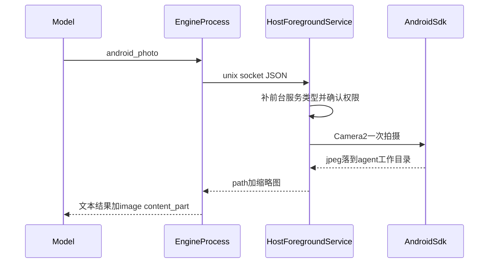

# Android 设备内置工具

- **状态**：已实现。桥、八个工具、权限入口和前台服务类型都在代码里。真机步骤见 `apps/android/DEVICE_SMOKE.md`。
- **日期**：2026-11-19
- **相关**：[ADR-AND-001](../../adr/zh/ADR-AND-001-android-host-profiles-and-execution-backend.md)、[ADR-AND-003](../../adr/zh/ADR-AND-003-independent-engine-and-spawn-contract.md)
- **目的**：让装在手机上的 agent 使用 App 进程里已经能申请到的硬件能力（拍照、录像、录音、播放、BLE、USB HID）。这些能力走一组只在本 App 注册的内置工具，安装后默认开启。工具的参数按公开 Android SDK 留全，用法由以后的 skill 来写。

---

## 1. 为什么不走 shell

今天 agent 碰到手机只有 shell 一条路。[`ShellTool`](../../../crates/vendor/acowork-runtime/src/tools/builtin/shell.rs) 在 `android-host` 下走 [`android_exec`](../../../crates/vendor/acowork-runtime/src/android_exec.rs)，再进 [`ExecutionBackend`](../../../crates/acowork-android/src/host/backend.rs)。这条链只认五个 shell / 文件系统 capability。APK 沙箱档的 backend 会直接拒绝 exec。

录音、播放、拍照、录像、BLE、USB HID 都是 App 在拿到权限之后调用的 SDK，系统没有把它们暴露成命令。引擎也调不到这些 API：[`HostForegroundService`](../../../apps/android/app/src/main/java/com/acowork/androidhost/HostForegroundService.kt) 拉起的是另一个进程里的 `libacowork_engine.so runtime`，JNI 只有 Kotlin 调 Rust（[`Native.kt`](../../../apps/android/app/src/main/java/com/acowork/androidhost/Native.kt)）。权限按 UID 授予，子进程继承得了授权，但 Android 14 起相机、麦克风和蓝牙还必须由带对应 `foregroundServiceType` 的前台服务持有，系统弹窗也只能由 Activity 拉起。

因此工具的名字和参数放在引擎里，硬件动作放在 App 进程里。两边用本应用私有目录中的 Unix socket 通信。shell 的 capability 词表不动，引擎也不并回 App 进程。

## 2. 注册与默认开启

八个工具只在 `android-host` 打开、且环境变量 `ACOWORK_DEVICE_BRIDGE` 有值时注册。桌面 runtime 不编这组工具，创建 agent 的向导列表 [`BUILTIN_TOOLS`](../../../crates/vendor/acowork-core/src/tools/mod.rs) 也不加入它们。手机上该 agent 的 Tools 面板能看到它们，因为 runtime 会把它们写进 `{work_dir}/config/agent_tools.json`。

现有规则会把新工具关掉：首次启动只打开 manifest `[[tools]]` 里点名的工具（[`init_tools_config_from_manifest`](../../../crates/vendor/acowork-runtime/src/agent_config.rs)），之后新出现的工具在 [`merge_tools_config`](../../../crates/vendor/acowork-runtime/src/agent_config.rs) 里默认 `enabled = false`。手机上装的 agent 包不会列出这些名字。

例外只覆盖下面这八个名字，并且只在桥存在时生效：

- `android_device_status`
- `android_photo`
- `android_video_record`
- `android_audio_record`
- `android_audio_play`
- `android_ble_scan`
- `android_ble_gatt`
- `android_usb_hid`

第一次写入 `agent_tools.json` 时，这组工具 `enabled = true`，不管 manifest 有没有写。升级后第一次出现在代码注册表里时，同样默认打开。文件里已经有这一行时，沿用用户的开关。

它们不放进 `PROTECTED_TOOL_NAMES`。用户可以在现有 `PUT /agents/{id}/builtin-tools` 上关掉麦克风、蓝牙或 USB HID，下次启动保持关闭。

工具说明保持短：对应哪组公开 API、缺省时平台默认是什么。具体怎么组合留给 skill。schema 要把 App 拿得到的参数和回调字段留下来，skill 才写得了。

## 3. 参数原则

公开 SDK 的范围是 compileSdk 35、minSdk 26。`@hide` 和 `@SystemApi` 不包。某个键需要更高 API 时，设备不够就返回 `unsupported_api`，并带上需要的 API 级别。

键值表整表透传。拍摄和录像用 Camera2，因为 CameraX 会吃掉 `CaptureRequest`。`capture_request`、`capture_result`、相机 `characteristics`、BLE 的 `settings` / `filters` / `ScanResult`、USB 的描述符和 `controlTransfer` 参数，都以 SDK 公开字段为准。实现时漏键算缺陷。调用方写了未知键，返回 `invalid_argument`，字段不静默丢掉。

缺省等于该 API 的平台默认，所以只填路径或 `op` 也能完成一次普通调用。每个 JSON schema 字段的描述写明单位、枚举、默认值和对应的 Android 类型。

返回值带上回调里的状态码和字段，字段名稳定。二进制超过工具输出预算（现有 32KB 包装）时写成 `{work_dir}/device-captures/` 下的文件，结果里给 `path`、`length`、`sha256` 和一段短十六进制前缀。参数 `output` 取 `inline` 或 `file`，缺省是放得下就内联，放不下就落文件。媒体文件不进系统相册。

传输长度以端点 `maxPacketSize`、协商好的 ATT MTU、以及调用方给的 `length` 为准。工具层不再另设 64 字节、512 字节这类截断。

同一相机、同一只麦克风、同一个 USB 设备、同一条 GATT 连接、一次 BLE 扫描，同时只服务一个调用，冲突立刻返回 `busy`（带上占用者 agent），不排队。录音和播放可以并行。不同 agent 可以同时播放（最多 4 路 MediaPlayer）。不同 USB 设备、不同 GATT 地址可以并行。

手机上每个 agent 是独立引擎进程，都会短连接到同一条 `device-bridge.sock`。桥侧最多 16 个进行中的调用；满了立刻 `busy`，不把后来的 status / 拍照堵在 `play_and_wait` 后面。请求行 10 秒内读完，之后这条连接可以占到工具自己的超时。审计按行加锁。引擎连不上套接字时短暂重试。`android_device_status` 的 `bridge` 段能看到 inflight 和独占占用者。

共用错误码：

| 错误码 | 含义 |
|---|---|
| `permission_required` | 权限或 USB 设备授权还没有。桥同时发一条通知，点开进宿主界面去申请 |
| `unsupported_api` | 这个字段存在，但当前系统版本没有对应 API。带上所需 API 级别 |
| `invalid_argument` | 未知键、枚举非法、路径越出该 agent 的 work dir |
| `busy` | 同一独占设备上已有进行中的调用 |
| `bridge_unavailable` | `ACOWORK_DEVICE_BRIDGE` 指向的套接字连不上 |

## 4. 工具

### 4.1 `android_device_status`

无副作用。不申请权限，不占用相机、GATT 或 USB 接口。`sections` 缺省为全部：`permissions`、`features`、`cameras`、`audio_devices`、`microphones`、`bluetooth`、`usb`、`bridge`。`output` 见 §3。

- `bridge`：进行中的桥调用数、上限、相机 / 麦克风 / BLE scan 的占用者。不申请权限。
- `permissions`：本 App 已声明权限的授予结果，外加 USB 每台设备的 `hasPermission`。
- `features`：`PackageManager.hasSystemFeature` 里和这些工具有关的特征，含 `android.hardware.camera`、`camera.front`、`camera.autofocus`、`camera.flash`、`microphone`、`bluetooth`、`bluetooth_le`、`usb.host`、`audio.low_latency`、`audio.pro`。
- `cameras`：`CameraManager.getCameraIdList` 的每个 id，带上 compileSdk 35 全部公开 `CameraCharacteristics.Key`。至少覆盖面向、传感器方向、像素阵列、active array、焦距、光圈、最小对焦距离、ISO 范围、曝光时间范围、曝光补偿范围和步长、AE/AF/AWB 可用模式、闪光是否可用、最大数字变焦、`CONTROL_ZOOM_RATIO_RANGE`、光学防抖和视频防抖、可用场景和特效、硬件等级、`REQUEST_AVAILABLE_CAPABILITIES`、各格式在 `StreamConfigurationMap` 里的尺寸、最小帧间隔和 stall。
- `audio_devices`：`AudioManager.getDevices` 的输入和输出。每台设备保留 id、type、product name、address、isSource、isSink、channel counts、channel masks、channel index masks、encodings、sample rates。
- `microphones`：API 28+ 的 `MicrophoneInfo`：id、位置、方向、频率响应、灵敏度、指向性、type、address、group、channel mapping。
- `bluetooth`：适配器状态、是否支持 LE、本机名、已配对设备的 address、name、alias、type、bond state、已缓存的 UUID。
- `usb`：当前设备列表。描述符字段与 §4.8 的 `list` 相同。这里不 claim 接口。

agent 用它判断要不要请用户去点通知。

### 4.2 `android_photo`

一次静帧，文件为 JPEG。模型侧附一张缩小预览（`content_parts`，做法与 [`image_read`](../../../crates/vendor/acowork-runtime/src/tools/builtin/image_read.rs) 相同），原图只走路径。

- `camera_id`，或在缺省时用 `lens_facing`：`front`、`back`、`external`，默认 `back`。
- `template`：`still`、`manual`、`preview`，对应 `TEMPLATE_STILL_CAPTURE`、`TEMPLATE_MANUAL`、`TEMPLATE_PREVIEW`，默认 `still`。
- `output_path`、`output`。
- `warmup_frames`：拍摄前先跑多少帧让 AE/AF 收敛。自动对焦时默认一个小值，手动模板下默认 0。
- `capture_request`：对象，键名是 `CaptureRequest.Key` 的名字。实现覆盖 SDK 35 的全部公开键，按组至少包括：控制（`CONTROL_MODE`、AE/AF/AWB 模式与锁、曝光补偿、AE/AF 区域、预捕获和 AF trigger、目标帧率、变焦、场景、特效、视频防抖、`CONTROL_CAPTURE_INTENT`、ZSL、扩展场景模式）、传感器（感光度、曝光时间、帧间隔、测试图）、镜头（对焦距离、光圈、焦距、滤镜、光学防抖）、闪光、`SCALER_CROP_REGION`、JPEG（质量、方向、GPS、缩略图质量和尺寸）、后处理（降噪、锐化、坏点、阴影、色调映射、颜色校正、畸变校正、人脸检测及相关统计开关）。
- `jpeg_quality`、`jpeg_orientation`、`location` 是 JPEG 键的便捷入口。和 `capture_request` 里的同名键冲突时以 `capture_request` 为准。

返回 `path`、宽高、`mime`、实际用到的 `camera_id`，以及这次 `TotalCaptureResult` 里出现的全部 `CaptureResult` 键（曝光、ISO、焦距、光圈、对焦距离、AE/AF/AWB/FLASH 状态、时间戳、裁剪区域、人脸统计等）。

### 4.3 `android_video_record`

`MediaRecorder` 加 Camera2 录像模板。`op` 为 `start`、`stop`、`status`。带了 `duration_ms` 时，一次调用录完再返回。视频不放进上下文。

- 相机：`camera_id`、`lens_facing`、`template` 默认 `record`。`capture_request` 与拍照同一套键。
- 封装和编码：`output_format`（`mpeg_4`、`webm`、`three_gpp`）、`video_encoder`、`audio_encoder`。枚举用 `MediaRecorder.OutputFormat`、`VideoEncoder`、`AudioEncoder` 的全部公开值。
- `camcorder_profile`：`CamcorderProfile` 的 quality 名，含普通、timelapse、high speed。显式字段覆盖 profile 里的对应项。
- 视频：`video_size`、`video_bit_rate`、`video_frame_rate`、`capture_rate`、`orientation_hint`。
- 音频：`audio_enabled`、`audio_source`、`audio_sample_rate`、`audio_bit_rate`、`audio_channels`。`audio_source` 用 `MediaRecorder.AudioSource` 的公开值。
- 文件：`output_path`、`max_duration_ms`、`max_file_size_bytes`、`location`。这三项就是 `setMaxDuration`、`setMaxFileSize`、`setLocation`。`max_duration_ms` 缺省 10 分钟；传 0 表示不设上限。录制期间通知保持。
- `preferred_device_id`、`privacy_sensitive`：对应 API 28 的 `setPreferredDevice` 和 API 30 的 `setPrivacySensitive`。

返回 `path`、`duration_ms`、`mime`、`size_bytes`、实际 profile、被显式覆盖的字段、`camera_id`。

### 4.4 `android_audio_record`

压缩格式走 `MediaRecorder`，PCM 走 `AudioRecord`。`op` 为 `start`、`stop`、`status`，或用 `duration_ms` 一次录完。内容不进上下文。

- `container`：`aac_m4a`、`amr_nb`、`amr_wb`、`opus`、`wav`、`raw_pcm`。
- `audio_source`：`default`、`mic`、`camcorder`、`voice_recognition`、`voice_communication`、`unprocessed`、`voice_performance`、`voice_uplink`、`voice_downlink`、`voice_call`。取值对应 `MediaRecorder.AudioSource` 与 `AudioRecord` 共用的那组公开源。
- PCM：`sample_rate`、`encoding`（`pcm_8bit`、`pcm_16bit`、`pcm_float`、`pcm_24bit`、`pcm_32bit`）、`channel_mask`、`channel_index_mask`、`buffer_size_bytes`。
- 压缩：`bit_rate`，以及和录像相同的 `max_duration_ms`、`max_file_size_bytes`。
- `preferred_device_id`、`privacy_sensitive`。公开的 `AudioRecord.Builder` 没有 `setSessionId`，传入 `audio_session_id` 会返回 `unsupported_api`。系统分配的 id 在结果里返回。
- `effects`：`aec`、`ns`、`agc`。设备有对应的 `AcousticEchoCanceler`、`NoiseSuppressor`、`AutomaticGainControl` 才打开。

返回 `path`、时长、容器、设备实际采用的采样率、编码、声道掩码、`audio_session_id`、`device_id`，以及三项效果各自是否真的启用。

### 4.5 `android_audio_play`

`MediaPlayer`。路径必须在该 agent 的 work dir 内。`op`：`play_and_wait`、`start`、`pause`、`resume`、`stop`、`seek`、`status`。

- `audio_attributes`：`usage`、`content_type`、`flags`、`capture_policy`。枚举用 `AudioAttributes` 的公开常量。另留 `stream_type` 作为 `setAudioStreamType` 的入口。
- `volume`，以及 `left_volume`、`right_volume`。
- `loop`。
- `seek_ms` 加 `seek_mode`：`previous_sync`、`next_sync`、`closest_sync`、`closest`。
- `playback_speed`、`pitch`、`audio_fallback_mode`，对应 `PlaybackParams`。
- `preferred_device_id`、`audio_session_id`。
- `aux_effect_id`、`aux_effect_send_level`，对应 `attachAuxEffect` 和 `setAuxEffectSendLevel`。

返回 `duration_ms`、`position_ms`、是否在播、`audio_session_id`、当前输出 `device_id`。

`AudioEffect`（均衡器、混响、`LoudnessEnhancer`、`DynamicsProcessing`）这次不单开工具。录音和播放都接受并返回 `audio_session_id`，后面要挂效果器可以直接接上。

### 4.6 `android_ble_scan`

`BluetoothLeScanner.startScan(filters, settings, callback)`。`duration_ms` 默认 10000。

- `settings` 对应 `ScanSettings.Builder` 的全部公开项：`scan_mode`、`callback_type`、`match_mode`、`match_num`、`report_delay_ms`、`phy`、`legacy`。
- `filters` 是数组，元素对应 `ScanFilter.Builder` 的全部公开项：设备名、地址、service UUID 和 mask、service data 和 mask、manufacturer id 加 data 和 mask、service solicitation UUID 和 mask、advertising data type 加 data 和 mask（API 33）。多个 filter 的关系与系统一致，是或。
- `include_raw` 默认 true。

每条 `ScanResult` 原样返回：地址、名称、alias、设备类型、bond state、rssi、timestamp nanos、primary phy、secondary phy、advertising SID、tx power、periodic advertising interval、isConnectable、isLegacy、data status。`ScanRecord` 返回 flags、设备名、service UUID、service data、manufacturer data、tx power、solicitation UUID，以及原始广播字节。

### 4.7 `android_ble_gatt`

`op` 与公开方法对应：`connect`、`disconnect`、`close`、`discover_services`、`list`、`request_mtu`、`request_connection_priority`、`set_preferred_phy`、`read_phy`、`read_rssi`、`read`、`write`、`read_descriptor`、`write_descriptor`、`subscribe`、`unsubscribe`、`create_bond`、`fetch_uuids`、`get_bond_state`、`status`。扫描在 §4.6。

- 连接：`address`、`auto_connect`、`transport`（`auto`、`br_edr`、`le`）、`phy_mask`、`phy_options`、`timeout_ms`。
- 目标：`service_uuid`、`service_instance_id`、`characteristic_uuid`、`characteristic_instance_id`、`descriptor_uuid`。同一 UUID 多实例时用 instance id 区分。
- 写入：`value_hex`、`write_type`（`default`、`no_response`、`signed`）。长度受当时 MTU 约束。
- `mtu`、`priority`（`balanced`、`high`、`low_power`）、`tx_phy`、`rx_phy`。
- 订阅：`notification` 为 `notify` 或 `indicate`，并按此写 CCCD。`subscribe_wait_ms` 是这次调用收集回调的窗口。窗口之外的通知留在桥里，用 `op=status` 取走。

`list` 返回完整服务树：服务 UUID、instance id、primary 或 secondary、included services；特征的 UUID、instance id、properties、permissions、write type；描述符的 UUID、permissions、当前值（若已知）。读写和订阅的返回里带 `gatt_status`。连接类操作还带 `connection_state`、`mtu`、`rssi`、`tx_phy`、`rx_phy`。

### 4.8 `android_usb_hid`

手机当 USB Host，操作插在手机上、至少有一个接口类码为 3 的设备。公开 SDK 没有把手机变成 HID 键盘的接口，`/dev/hidg*` 那条路不在这个工具里。

`op`：`list`、`open`、`close`、`claim`、`release`、`set_configuration`、`set_interface`、`control_transfer`、`transfer`、`get_raw_descriptors`。`open` 发现这台设备还没有 `UsbManager` 授权时返回 `permission_required`。

- 选设备：`device_id`、`device_name`，或 `vendor_id` + `product_id` + `serial`。
- `claim` / `release`：`interface_id`、`alternate_setting`、`force_claim`。`open` 可以带一份同样的 claim 参数。`idle_timeout_ms` 默认 60000，超时 `releaseInterface`；传 0 表示一直占到 `close`。
- `set_configuration`：`configuration_id`。
- `control_transfer` 保留方法的每个参数：`request_type`、`request`、`value`、`index`、`data_hex`、`length`、`timeout_ms`。GET_DESCRIPTOR、GET_REPORT、SET_REPORT、SET_IDLE、SET_PROTOCOL 都由 skill 用这组参数来组。工具不另做一套 HID 专用缩写。
- `transfer`：`endpoint_address`（或 `endpoint_number` + `direction`）、`data_hex`、`length`、`timeout_ms`。中断端点在 Android 上就是 `UsbDeviceConnection.bulkTransfer`。
- `get_raw_descriptors`：返回设备原始描述符。HID report descriptor 由 skill 自己从这里解析。
- `output`：`inline` 或 `file`。

`list` 的每台设备带上：`deviceId`、`deviceName`、vid、pid、device class / subclass / protocol、厂商、产品、序列号、版本、`hasPermission`；每个 configuration 的 id、name、max power、self powered、remote wakeup；每个 interface 的 id、alternate、class / subclass / protocol、name；每个 endpoint 的 address、number、direction、type、maxPacketSize、interval、attributes。

## 5. 设备桥

[`HostForegroundService`](../../../apps/android/app/src/main/java/com/acowork/androidhost/HostForegroundService.kt) 在 `Native.startNode` 之前拉起桥，停服务时关掉。

套接字文件和令牌放在 node home（`filesDir/acowork`）下，目录本身是应用私有的。请求带令牌。不用本机 TCP，因为同机其它 App 也能连 `127.0.0.1`；也不用 abstract namespace。

[`ProcessTable::start`](../../../crates/acowork-android/src/node/process.rs) 拉引擎时把 `ACOWORK_DEVICE_BRIDGE=路径|令牌` 放进子进程环境。引擎侧工具每次调用短连接，桥还没起来就短暂重试。

协议是一行一个 JSON，带版本号。Kotlin 与 Rust 各写一份结构。照片和音视频不走 socket，只走路径。

前台服务类型从现在的单独 `dataSync` 改成清单里声明 `dataSync|camera|microphone|mediaPlayback|connectedDevice`。启动时仍然只用 `dataSync`。某次操作开始前，在已经授予对应权限的前提下，`startForeground` 加上那一种类型，通知文案写成正在使用摄像头、麦克风、蓝牙或 USB，做完退回 `dataSync`。没授权就不带上那种类型，否则 `startForeground` 会抛 `SecurityException`。USB 和 BLE 共用 `connectedDevice`。

权限在现有 `CAMERA`（目前只给扫码）之外补上：

- `RECORD_AUDIO`
- `FOREGROUND_SERVICE_CAMERA`
- `FOREGROUND_SERVICE_MICROPHONE`
- `FOREGROUND_SERVICE_MEDIA_PLAYBACK`
- `FOREGROUND_SERVICE_CONNECTED_DEVICE`
- `BLUETOOTH_SCAN`（`neverForLocation`）
- `BLUETOOTH_CONNECT`
- API 30 及以下的 `BLUETOOTH`、`BLUETOOTH_ADMIN`

USB Host 没有运行时权限字符串。声明 `android.hardware.usb.host` 且 `required=false`，真正的授权是 `UsbManager.requestPermission` 对单台设备弹出的系统框。清单里不加 `USB_DEVICE_ATTACHED` 的自动占用，避免一插上键盘就被本 App 抢走。

工具发现权限不够时，桥返回 `permission_required`，并发一条通知，点开进现有界面去申请。工具文案告诉模型：请用户点通知，然后再试。后台在没有 Activity 时拉不起系统权限框。主界面加一组设备能力开关，用户也可以提前授权。

审计写到 `{home}/device-audit.jsonl`：时间、agent、工具名、参数里的非敏感字段、结果路径、成败。不记音频内容、BLE 载荷和 HID 报告内容。USB 一行只记 vid、pid 和 `op`。多 agent 并行写同一文件时按行加锁。

### 5.1 并发与性能

多个 agent（各自一个 engine 进程）会同时打到同一座桥。约束按资源，不按“全桥单线程”。

| 层 | 行为 |
|---|---|
| 连接 | 每次工具调用一条短 Unix 连接。accept 线程不跑硬件。工作线程 `core=4 / max=16`，队列是 `SynchronousQueue`：第 17 路立刻 `busy`，不排队 |
| 独占 | 相机、麦克风、BLE scan 各一把 CAS 锁，占用者是 `agent_id`。GATT 按地址、USB 按 `deviceId` 归属到打开它的 agent；别人碰返回 `busy` |
| 可并行 | `android_device_status`、不同地址的 GATT、不同 USB 设备、录音与播放、最多 4 路播放 |
| 会话内 | 同一条 GATT 连接、同一台 USB 设备上的 transfer 串行，避免回调 latch 和 `UsbDeviceConnection` 交叉 |
| 客户端 | `connect` 在 `NotFound` / `ConnectionRefused` 上退避重试约 300ms，避免引擎比桥的 listen 更早起来 |

长调用（`play_and_wait`、带 `duration_ms` 的录制、BLE scan）会占住一个工作线程直到返回。所以上限按“同时进行中的设备调用”计，而不是按 agent 数。超过就 `busy`，让模型换时间再试，而不是在桥里排队把别的 agent 拖死。

## 6. 代码放哪

依赖方向维持现状：[`acowork-android`](../../../crates/acowork-android/src/host/mod.rs) 不引用 runtime。

- `crates/acowork-android/src/device/`：协议结构、socket 客户端、错误码。引擎和单测都能用，不碰 Android SDK。
- `crates/vendor/acowork-runtime/src/tools/builtin/android_device/`：`Tool` 实现，`cfg(feature = "android-host")`。在 [`all_builtin_tools`](../../../crates/vendor/acowork-runtime/src/tools/builtin/mod.rs) 里，仅当 `ACOWORK_DEVICE_BRIDGE` 已设置时追加。schema 按本文第 4 节一次定完。
- `apps/android`：桥的 Server、各 handler、权限入口、前台服务类型切换。拍摄和录像用 Camera2。`CaptureRequest`、`CaptureResult`、`CameraCharacteristics` 的键表按 compileSdk 35 的公开常量生成，不手抄一份短名单。
- 默认开启的例外写在 `init_tools_config_from_manifest` 和 `merge_tools_config`。名单是第 2 节的八个名字，桥不在就不生效。

## 7. 实现顺序

分期只分实现顺序。schema 按第 4 节一次定完，不先做一个少参数的版本再追加，否则已经写好的 skill 会对不上。

1. 桥、`android_device_status`、拍照、录音、播放。这一期就要带上完整的 `capture_request` 和音频格式字段，并带上审计。
2. 录像。
3. BLE 扫描、GATT，以及 `android_usb_hid`（含 `control_transfer` 和原始描述符）。

验证：Rust 侧用假 socket 测协议，以及桥不在则不注册。真机在 [`DEVICE_SMOKE.md`](../../../apps/android/DEVICE_SMOKE.md) 加一节：授权后从 agent 调拍照和短录音，确认文件出现在 work dir；没授权时返回 `permission_required`，而不是一次空成功。
