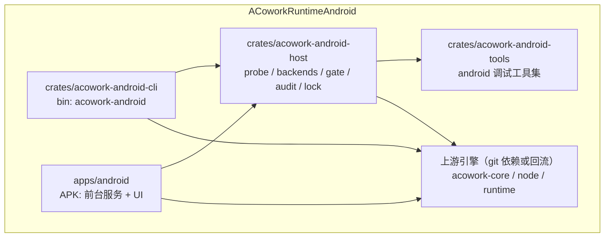
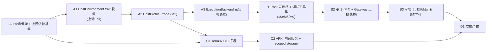

# ADR-AND-001 实施计划：Android 宿主档位、ExecutionBackend 与启动探测

- **日期**：2026-05-16
- **范围**：本仓库（ACoworkRuntimeAndroid）全部交付物 —— Rust 工具栏（`acowork-android`）、APK 工具栏（`acowork-android-app`）、向上游 `acowork-core` / `acowork-node` / `acowork-runtime` 的扩展点回流
- **状态**：Draft —— 等待 §9 的两项裁决（D0 / D5）后进入实施
- **关联**：
  - [ADR-AND-001](../../adr/zh/ADR-AND-001-android-host-profiles-and-execution-backend.md)（宿主档位与执行后端）
  - [android-host-probe.md](../../design/zh/android-host-probe.md)（启动能力探测）
  - [README.md](../../../README.md)（两个交付物 / Roadmap）
  - 上游 `docs/design/zh/12-tool-system.md`（§2.1 平台支持矩阵、§2.2 跨平台降级、运行时平台检测）
  - 上游 `docs/adr/zh/ADR-055`（Node 拓扑与 `NodeInfo` 上报）、`ADR-075`（node identity）、`ADR-087`（owner 门控）、`ADR-090`（能力归 Node）

---

## 0. 结论摘要

ADR-AND-001 已经定案**做什么**（三档宿主、工具级提权、探测驱动、先读后写）。本计划解决**怎么落地**：
把它拆成 3 条独立可交付的轨道、11 个模块、6 个阶段，每个阶段都有明确的验收口径与回滚开关。

三条轨道（互相解耦，可并行）：

| 轨道 | 内容 | 对应 ADR/README |
|---|---|---|
| **A · 平台抽象**（portability） | 把上游对「宿主」的硬编码判断收敛为 trait，本仓库提供 Android 实现与启动探测 | README #2/#5、ADR-AND-001 §4.2、probe 设计 |
| **B · 执行能力**（capability） | `ExecutionBackend` 三实现、能力门控、审计、DeviceWriteLock、回滚、调试工具集 | ADR-AND-001 §4.4–§4.7、§6 P0–P4 |
| **C · 交付形态**（delivery） | Termux CLI、APK（前台服务 + scoped storage）、发布产物 | README #3/#4/#7 |

关键判断（详见 §2）：**A 轨必须先于 B 轨**，因为 `ExecutionBackend` 的存在前提是平台判断已从 `match std::env::consts::OS` 收敛成可注入的抽象；否则 Android 只会落进上游 `platform.rs` 的 `_ =>` 分支，注册出一个语义错误的 `shell` 工具。这是本计划里唯一的硬性排序约束。

---

## 1. 事实基线

### 1.1 本仓库现状（实测）

`git log` 仅 2 个提交（`chore: initialize`、`docs(adr): add ADR-AND-001`）。当前只有 README（中/英）+ 两份文档，**零代码、零 Cargo 工程**。README §"Repository layout" 与 §Roadmap 里所有条目均为 🚧/⬜ 计划态。

### 1.2 上游可复用资产（逐个核实过）

| 上游资产 | 位置 | 对本计划的意义 |
|---|---|---|
| 运行时平台检测 + shell 枚举 | `core/acowork-runtime/src/platform.rs`（`detected_shells() -> Vec<AvailableShell>`、`ShellInfo`、`OnceLock` 缓存） | **改造点**：目前是 `match std::env::consts::OS` 的硬编码实现，Android 会落到 `_ =>` 分支，注册一个名为 `shell` 的统一工具 —— 与 ADR-AND-001 §4.5「bash/ash 双注册」冲突 |
| 多 shell 双注册范式 | `core/acowork-runtime/src/tools/builtin/shell.rs`（按 `tool_name` 生成不同描述与 fallback 提示）、`tools/builtin/mod.rs`（由 `detected_shells()` 装配工具） | **直接沿用**：Android 的 `bash` / `ash` 只是这套范式的两个新实例 |
| 平台摘要注入 System Prompt | `core/acowork-runtime/src/agent/context.rs`（`detected_shell()` / `detected_shells()`） | **扩展点**：宿主摘要（profile/privilege/selinux/fs_roots/caps）复用同一注入位置 |
| 审批门 | `core/acowork-runtime/src/security/approval_gate.rs`（`ApprovalGate` trait、`ApprovalRequest`）、`agent/loop_tools.rs`（`check_shell_approval*`）、`acowork-core/src/permission.rs`（`ShellApprovalThreshold`） | **复用**：ADR-AND-001 §4.4 要求复用 session 级审批，不新建子系统 |
| 风险分级 | `core/acowork-runtime/src/security/shell_risk.rs` + `shell_risk_rules.toml`（Low/Medium/High/Blocked，规则可被工作区覆盖） | **扩维**：现有规则是「命令内容 → 风险」，Android 需要「命令 → 所需 capability」的第二维 |
| 结构化审计 | `core/acowork-runtime/src/security/audit_log.rs`（`ShellAuditEntry`，JSON） | **扩字段**：需补 `uid / selinux context / capability / avc denials / duration_ms` |
| 文件溯源 / fs watcher | `core/acowork-runtime/src/security/file_provenance.rs`、`fs_watcher.rs` | 写档回滚的既有基础 |
| Node 上报通道 | `acowork-core/proto/mqtt_payload.proto`：`NodeInfo.capabilities`（field 7，`repeated string`）、`NodeEnroll.capabilities`（field 6）；`acowork-node/src/control/mod.rs::build_node_info` 目前只填 `vec!["control_plane"]` | **现成插槽**：ADR-AND-001 §7.1 的「能力摘要上报」可落在 `capabilities` 上，但粒度信息（profile/privilege/dialect）如何编码是 §2 D5 待裁决 |
| Owner 门控 | 上游 ADR-087（Gateway 反代入口单点鉴权、fail-closed、`node_owners.json`） | `android:fs:system` / `android:selinux:permissive` 的「归属门控」闸之一，本计划只做**与本地开关的与运算**，不改 ADR-087 |

### 1.3 差距清单（gap）

1. 本仓库无工程骨架、无目标三元组配置、无 CI。
2. 上游平台判断无 trait 边界，Android 分支缺失且会**静默降级为错误的工具集**（不是「没有 shell 工具」，而是「有一个行为错乱的 shell 工具」）。
3. 上游无 `ExecutionBackend` 抽象：shell 执行是具体类型 `ShellTool`，没有「同一引擎、可换执行后端」的缝。
4. 上游审批是**风险阈值驱动**（`ShellRisk` vs `ShellApprovalThreshold`），没有**能力驱动**（`android:shell:write` 这类声明式 gating）。ADR-AND-001 §4.4 要求的能力模型需要新增一维。
5. 无启动探测（HostProfile 不存在）。
6. `NodeInfo.capabilities` 是扁平 tag 列表，未承载 profile/privilege/方言（ADR-AND-001 §7.1 需要）。
7. 无 DeviceWriteLock（ADR-AND-001 §7.2 定案的新架构件）。
8. 审计无 uid/SELinux 域/avc 拒绝结构化字段（ADR-AND-001 §4.6 要求）。

---

## 2. 关键架构决策

### D0 · 引擎归属：本仓库如何消费上游引擎【待裁决】

三个交付物共享同一引擎（README 明确）。问题是从哪里拿到这个引擎。

| 选项 | 做法 | 优点 | 缺点 |
|---|---|---|---|
| **A（推荐）** | 本仓库以 **git 依赖**消费上游 `acowork-core` / `acowork-node` / `acowork-runtime`；把「平台抽象」作为**上游 PR**（`HostEnvironment` trait + 扩展点）落库；本仓库只新增 Android 侧实现 crate | 一份引擎、无双份漂移；完全符合 README「干净回流路径」；上游契约不变 | 强依赖上游接受 trait 提取，A 轨起步会被上游评审节奏阻塞 |
| B | vendor（复制）上游 node/runtime crate 到本仓库，本地改造，后置回流 | 不被上游阻塞，起步快 | 双份引擎，与「两个交付物共享一份引擎」和「不新增第二套 Runtime 语义」（ADR-AND-001 F3）直接冲突；回流 diff 巨大 |
| **C（A 的兜底）** | 先做 B 以验证 trait 形状（spike），trait 稳定后切换 A | 用最小代价探明改造面 | 需要显式清理 spike 代码，不能长期并存 |

**推荐 A**；若上游 PR 吞吐不足，退 C（时限内 spike → 切换），**明确拒绝长期 B**。
裁决点：谁来把上游 PR 推上去（本仓库维护者 or 上游团队），以及是否接受「A 轨前期以 spike 形式并行」。

> 无论选哪个，**接口形状与本节后续决策（D1–D6）不变** —— 它们定义的是契约，不是落点。

### D1 · `ExecutionBackend` 的最小契约

沿用 ADR-AND-001 §4.7，只作为**执行原语**，不含业务语义：

```rust
#[async_trait]
pub trait ExecutionBackend: Send + Sync {
    /// 执行一段脚本（脚本体走 stdin，禁止进 argv —— ps 可见会泄露敏感参数）
    async fn exec(&self, req: ExecRequest) -> Result<ExecOutcome, ExecError>;
    /// 该后端能提供的执行上下文事实（uid / context / 方言）
    fn facts(&self) -> BackendFacts;
}

pub struct ExecRequest { pub script: String, pub cwd: Option<PathBuf>, pub env: Vec<(String,String)>,
                         pub timeout: Duration, pub capability: AndroidCapability, pub approval_token: Option<ApprovalToken> }
pub struct ExecOutcome { pub stdout: String, pub stderr: String, pub exit_code: i32,
                         pub selinux_denials: Vec<AvcDenial>, pub uid: u32, pub context: Option<String>,
                         pub duration_ms: u64, pub degraded: Vec<ProbeDegradation> }
```

三条不变量（测试要钉死）：
1. **有界**：`stdout`/`stderr` 沿用上游 shell 工具的 4KB 头 + 1KB 尾预算，超限截断并给可执行的再查询提示（复用 `shell.rs` 已有断言风格）。
2. **自证**：每次执行返回真实 `uid` + SELinux 域，用于审计，**不以探测结果为放行依据**（probe 设计 §4「探测 ≠ 保证」）。
3. **拒绝可回灌**：`selinux_denials` 必须被结构化抽取（不是把 stderr 原样丢给模型），并累计进会话内的 `observed_denials`。

### D2 · HostProfile 是数据契约，不是配置项

采纳 probe 设计 §3 的 `HostProfile` 结构，并**钉死推导规则**（capability = 探测事实的函数）：

```
android:shell:read          ← shell != None
android:shell:write         ← read ∧ (privilege >= Root ∨ su 探测成功)
android:fs:outside-app      ← ∃ fs_root.writable ∧ ¬is_own_package_dir
android:fs:system           ← verity != Enforcing ∧ /system 实测可 remount
android:selinux:permissive  ← privilege >= Root ∧ selinux == Enforcing
```

实现要求：推导函数是**纯函数**（`ProbeFacts -> CapabilitySet`），与探测执行（含子进程）分离 —— 这是 probe 设计 §7「单元层用伪造探测输出断言推导」得以成立的前提。

### D3 · 工具注册：沿用双注册范式，描述由探测生成

- `bash`（Termux / `$PREFIX`，POSIX + bash 扩展）与 `ash`（`/system/bin/sh` = mksh + toybox/busybox）**各注册为独立工具**，描述动态生成（哪些 applet 真实存在、`sed -i` 语义差异等），沿用 `shell.rs` 的「主工具 + fallback 提示」写法。
- 未进入 `caps` 的能力对应工具**不注册**（模型看不到即不会调用，与上游 12-tool-system §2.2 一致）。
- **反模式（显式阻断）**：不得注册一个「什么都能跑、失败再说」的通用 `shell`。那正是上游 `_ =>` 分支在 Android 上会产生的错误行为。

### D4 · 能力门控：新增一维，不污染 Agent manifest 的 Permission 词表

`android:*` capability **不进** `acowork-core::permission::Permission` 枚举。理由：`Permission` 是 **Agent manifest 声明**的权限词表（有紧凑二进制 tag 编码、随包分发），而宿主能力是**设备属性**、随设备变化，两者生命周期与权威来源都不同。混入会让「包声明了 `android:fs:system`」这种语义上无意义的状态出现。

落点：Android crate 内定义 `AndroidCapability` 枚举 + `CapabilityGate`，在**工具调用路径**（上游 `agent/loop_tools.rs::check_shell_approval*` 之前）插入一次 capability 判定：
- capability 来自 `HostProfile.caps`（探测推导）；
- 需要审批的 capability 复用既有 `ApprovalGate` + `ShellApprovalThreshold`（ADR-AND-001 §4.4 明确不新造子系统）；
- 硬禁列表（`dd of=/dev/block/*`、`rm -rf /data`、`wipe data`、`fastboot`、分区 `flash`）在 `ShellRisk::Blocked` 之上再加一层**不可被 dangerous-mode 覆盖**的拒绝（ADR-AND-001 §4.6.3）。

### D5 · 上报 Gateway 的编码方式【待裁决】

ADR-AND-001 §7.1 定案：上报 `profile` + `caps` 集合 + `shell dialect` + `privilege`，不上报设备细节。落到 `NodeInfo` 上有两条路：

| 选项 | 做法 | 优点 | 缺点 |
|---|---|---|---|
| **A（推荐）** | 复用 `NodeInfo.capabilities: repeated string`，用**受控 tag 词表**编码：`android:host-profile:root-shell`、`android:cap:shell:read`、`android:shell-dialect:mksh`、`android:privilege:root` | 零 proto 变更、零兼容风险（Gateway 只是展示/筛选，不解析）；与上游「capabilities 随阶段增长」的既有做法一致（ADR-055） | 结构化信息（privilege 等级）需要约定前缀，Gateway 侧解析时较脆 |
| B | 在 `NodeInfo` 新增 `AndroidHostSummary` 子消息（profile/dialect/privilege），payload 走 envelope 新字段 | 结构清晰、类型安全 | 改上游 proto（ADR-AND-001 显式声明「契约稳定、Gateway 不感知宿主档位」，与 N4 目标有张力）；字段号需要上游排期 |

**推荐 A**：`caps` 本来就是「可增长的 tag 集合」，且 ADR-AND-001 N4 要求「Gateway 不感知宿主档位」，A 让 Gateway 保持「只读标签、不建语义」。
裁决点：是否接受在 Gateway 侧出现 `android:*` 前缀的字符串约定（仅用于 UI 展示与筛选）。

### D6 · DeviceWriteLock 的落点

按 ADR-AND-001 §7.2 定案，**不加分布式锁**：一台设备一个 Node Agent，串行点天然存在。落点为本仓库 Node 侧进程内单点：

```rust
struct DeviceWriteLock { holder: Option<SessionId>, acquired_at: Instant, ttl: Duration /* 10min */ }
// acquire: 拿不到 → 立即 Err(LockHeldBy(holder))，不排队不抢占
// 每条 mutating 命令续期；read 类不取锁
```

---

## 3. 目标仓库结构与 crate 骨架



| 路径 | 内容 | 说明 |
|---|---|---|
| `crates/acowork-android-host/` | `HostProfile` 探测、`ExecutionBackend` trait + 3 实现、`CapabilityGate`、审计扩展、`DeviceWriteLock`、回滚 | 纯 Rust，无 Android SDK 依赖，**可在桌面用伪造探测输出单测**（probe 设计 §7 单元层） |
| `crates/acowork-android-tools/` | `logcat` / `dumpsys` / `screencap` / prop / `bugreportz` / ANR / tombstone 采集 | 依赖 `-host` 的 backend 契约；apk-sandbox 档下整体不注册 |
| `crates/acowork-android-cli/` | `acowork-android` bin（clap）、`--dangerous-mode` flag、Termux 生命周期 | 复用上游 node CLI 省略 |
| `apps/android/` | Gradle 工程、Kotlin 前台服务、scoped storage 映射、连通性回调 | 只 `JNI`/进程方式拉起 `-cli` 里的引擎 |
| `docs/` | 本目录（plan / design / adr） | 保持 zh 为源语言 |

工程约定（A0 阶段落地）：
- `rust-toolchain.toml` 固定版本；`.cargo/config.toml` 设 `aarch64-linux-android` 的 linker；
- 目标三元组：`aarch64-linux-android`（主）、`x86_64-linux-android`（模拟器）；
- **不引入 Android SDK 依赖进 `-host`/`-tools`**，SDK 只在 `apps/android`；这是「引擎保持平台无关、探测只是事实采集」的结构性保证。

---

## 4. 模块分解

每个模块独立交付、独立可测。列出的「测试边界」即该模块的验收口径。

### M1 · host-probe

| 项 | 内容 |
|---|---|
| 职责 | 启动时一次性采集 probe 设计 §2 的 12 项事实；串行预算 < 2s，单项超时 500ms 降级为 `Unknown` |
| 接口 | `ProbeFacts::collect(env: &dyn HostEnvironment) -> ProbeFacts`（`collect` 与 `derive` 分离） |
| 依赖 | `HostEnvironment`（D0 上游 trait）、`ExecutionBackend`（仅用于 `su -c` 探测项） |
| 测试边界 | 伪造探测输出（缺失命令 / 超时 / 畸形 `mount` 文本）→ 断言 `caps` 推导；三档 profile 快照作为回归基线 |
| 关联 | ADR-AND-001 P0、probe 设计 §2/§3/§7 |

### M2 · exec-backend

| 项 | 内容 |
|---|---|
| 职责 | `ExecutionBackend` trait + `TermuxBackend` / `AppSandboxBackend` / `RootShellBackend` 三实现 |
| 接口 | D1 的 `exec` / `facts`；`RootShellBackend` 内部为**无状态 `su -c`**（起步），脚本走 stdin |
| 依赖 | M1 的 `HostProfile`（决定注册哪一个）、M4 审计 |
| 测试边界 | 有界输出（4KB/1KB）、超时、非零退出码、`su` 拒绝、`avc: denied` 结构化抽取；集成层断言 root-shell 档下**无常驻 root 进程**（`ps -Z` 中 Runtime 自身仍是 `untrusted_app`） |
| 关联 | ADR-AND-001 §4.2/§4.7、P0/P1 |

### M3 · capability-gate

| 项 | 内容 |
|---|---|
| 职责 | `AndroidCapability` 枚举、`CapabilityGate`（探测推导的 caps ∧ 审批 ∧ 硬禁列表）、`observed_denials` 累计与「同一 tcontext 二次拒绝 → 提示勿重试」 |
| 接口 | `gate.check(cap, &req) -> Decision`；接入点为上游 `loop_tools.rs` 的 shell 审批路径**之前** |
| 依赖 | M1（caps 来源）、M4（审计）、上游 `ApprovalGate` |
| 测试边界 | 每个 capability 的默认放行/需审批/拒绝三态；dangerous-mode 关时 `android:fs:system` 一律拒绝；硬禁列表在 dangerous-mode 下仍拒绝 |
| 关联 | ADR-AND-001 §4.4/§4.6.3、§7.4（双条件与）|

### M4 · audit

| 项 | 内容 |
|---|---|
| 职责 | 扩展上游 `ShellAuditEntry`：补 `capability / uid / selinux_context / avc_denials / duration_ms / approval_kind` |
| 接口 | 在 M2 每次提权执行后写入；JSON 行格式不变（向后兼容） |
| 依赖 | 上游 `security/audit_log.rs` |
| 测试边界 | 每条命令可复现「capability + 实际上下文 + 退出码」；golden 快照 |
| 关联 | ADR-AND-001 §4.6.1、P2 |

### M5 · tool-registration + prompt-injection

| 项 | 内容 |
|---|---|
| 职责 | 按 `HostProfile.shell` 注册 `bash`/`ash`（描述由 `applets` 生成）；注入 ≤10 行宿主摘要（profile / privilege / selinux / 方言 / fs_roots / 已开放 caps / 写操作需审批声明）；未达能力不注册 |
| 接口 | 替换上游 `platform::detected_shells()` 的 Android 分支；复用 `agent/context.rs` 的注入位置 |
| 依赖 | M1、上游 `tools/builtin/mod.rs` + `shell.rs` |
| 测试边界 | apk-sandbox 档断言 **0 个 shell 工具**；termux 档断言 `bash` 且描述提到 `$PREFIX`；root 档断言 `ash` 且描述提到 mksh/toybox 与 `sed -i` 差异 |
| 关联 | ADR-AND-001 §4.5、probe 设计 §5.1/§5.2、12-tool-system §2.2 |

### M6 · gateway-report

| 项 | 内容 |
|---|---|
| 职责 | Node 侧在 `build_node_info` 填充宿主能力 tag；enroll 时 `NodeEnroll.capabilities` 同步 |
| 接口 | `capabilities: Vec<String>`（D5 词表）；**上报主体是 Node，不是 Runtime**（ADR-AND-001 §7.1） |
| 依赖 | M1、上游 `acowork-node/src/control/mod.rs` |
| 测试边界 | 三档 profile 各产生一份 tag 集合快照；断言**不含**设备序列号/型号/fs_roots 路径/context 原串/denials |
| 关联 | ADR-AND-001 §7.1、ADR-075 |

### M7 · device-write-lock

| 项 | 内容 |
|---|---|
| 职责 | Node 进程内 per-device 写锁（D6）；session 持有、TTL 10min、不排队不抢占、mutating 命令续期 |
| 接口 | `try_acquire(session_id) -> Result<Guard, LockHeldBy>`；read 类命令不经过锁 |
| 依赖 | Node 控制面 |
| 测试边界 | 并发双 Agent 争锁：后到者立即拿到 `LockHeldBy`（含持有者标识）；TTL 到期只释放；会话中断后锁可被重新获取 |
| 关联 | ADR-AND-001 §7.2、P3 |

### M8 · rollback

| 项 | 内容 |
|---|---|
| 职责 | 写操作前置备份（prop 旧值 / 文件备份到 Agent 工作区）、`restore` 入口、会话结束自动回滚（`persist.*` 需显式声明才保留）、`setenforce 0` 会话结束自动恢复 |
| 接口 | `RollbackRecord` + 会话生命周期钩子 |
| 依赖 | M3、M4、上游 `fs_watcher`/`file_provenance` |
| 测试边界 | 故障注入：会话中断后 prop 回滚生效；`/system` remount 失败时不留半改状态 |
| 关联 | ADR-AND-001 §4.6.4、§4.6.2、P3 |

### M9 · android-debug-tools

| 项 | 内容 |
|---|---|
| 职责 | `logcat -d`（buffer/filter）、`screencap`、`dumpsys <service>`、`/data/anr`、`/data/tombstones`、`bugreportz` 采集；全部属只读 capability |
| 接口 | 注册为独立工具（描述声明依赖的 capability 与降级行为） |
| 依赖 | M2（RootShellBackend）、M3 |
| 测试边界 | apk-sandbox/termux 档**不注册**；root 档注册；输出沿用有界截断预算 |
| 关联 | ADR-AND-001 §4.6.6、P2、README Roadmap #8/#9 |

---

## 5. 阶段划分



### A0 · 仓库骨架 + 上游依赖基座
- [ ] Cargo workspace、`rust-toolchain.toml`、`.cargo/config.toml`（android linker）、`.gitignore` 补 `target/`
- [ ] 决策 D0 落地：`Cargo.toml` 里写上上游依赖方式（git rev 锁定 / path）
- [ ] CI 骨架：`cargo check --all-targets --target aarch64-linux-android`、`clippy -D warnings`、`test`
- [ ] `crates/acowork-android-host` 空壳 + 第一个可在桌面跑的 `cargo test`
- **验收**：CI 三件套在 `aarch64-linux-android` 与 host 两个 target 上全绿；`-host` 无 Android SDK 依赖（用 `cargo tree` 断言）。
- **回滚**：无（纯新增）。

### A1 · 平台抽象收敛（上游）— **关键路径**
- [ ] 上游引入 `HostEnvironment` trait（`os()` / `shell_candidates()` / `spawn_probe()` / `fs_roots()`），把 `platform.rs` 的 `match std::env::consts::OS` 改为「默认实现 + 可注入实现」
- [ ] 上游 `detected_shells()` 语义保持字节级兼容（桌面行为零变化，回归测试为证）
- [ ] 本仓库提供 `AndroidHostEnvironment`
- **验收**：上游桌面单测全绿、行为零回归；Android 目标下 `detected_shells()` 的返回值**由本仓库实现决定**（不再是 `_ =>` 分支）。
- **回滚**：trait 默认实现 = 原逻辑，未注入时行为不变。
- **风险**：这是唯一需要上游合入 PR 的阶段 → 见 §9 D0 裁决。

### A2 · HostProfile Probe（M1）
- [ ] `ProbeFacts` 采集（12 项，独立超时 500ms，串行 <2s）
- [ ] `derive_caps` 纯函数（D2 五条规则）
- [ ] 三档 profile 快照 fixture + 解析器健壮性用例
- **验收**：probe 设计 §7 单元层全绿；畸形/缺失命令不 panic；快照 diff 即契约变更。
- **回滚**：探测失败 → `apk-sandbox`（最保守档）。

### A3 · ExecutionBackend 三实现（M2）
- [ ] trait + `TermuxBackend`（app uid、bash、`$PREFIX`）
- [ ] `AppSandboxBackend`（scoped storage、无 shell；文件操作继续走 `std::fs`，**不**统一到 backend —— probe 设计 §8.2）
- [ ] `RootShellBackend`（`su -c`、脚本走 stdin、无状态）
- **验收**：D1 三条不变量各有测试；`su` 弹窗被拒 → 降级为不提供 root 档且**不可重试**。
- **回滚**：root 档为独立可选实现，未启用时行为与现状一致（ADR-AND-001 §6 回滚路径）。

### B1 · root 只读档 + 调试工具集（M3 只读部分 / M5 / M9）
- [ ] `android:shell:read` 门控（白名单自动放行）
- [ ] 工具注册与 System Prompt 注入（M5）
- [ ] 调试工具集（M9）
- **验收**：真机跑通 `getprop` / `dumpsys` / `logcat -d`；断言无常驻 root 进程；apk-sandbox 档 0 个 shell 工具。
- **回滚**：删除 root 档配置即回到 Termux 档。

### B2 · 审计（M4）+ Gateway 上报（M6）
- [ ] 审计字段扩展 + golden 快照
- [ ] `NodeInfo.capabilities` / `NodeEnroll.capabilities` 填充（D5 词表）
- **验收**：每条命令可复现 capability 与上下文；上报快照不含敏感字段。
- **回滚**：上报失败不影响本地执行（展示用途）。

### B3 · 写档（M3 写能力 / M7 / M8）
- [ ] `android:shell:write` / `android:fs:outside-app` / `android:fs:system` / `android:selinux:permissive` 逐条审批
- [ ] `--dangerous-mode`（CLI flag + 环境变量兜底，每次会话显式开启，不持久化）
- [ ] DeviceWriteLock（M7）
- [ ] 回滚（M8）+ 硬禁列表
- **验收**：故障注入三条 —— 会话中断后 prop 回滚生效；并发双 Agent 争锁不互相污染；dangerous-mode 关闭时 `android:fs:system` fail-closed。
- **回滚**：写能力是新增 capability，默认不开放。

### C1 · Termux CLI 打通
- [x] `acowork-android serve --gateway-http ...`：MQTT enroll 真实 Gateway、启动/停止 agent、`/fs/browse`
- **验收**：与真实 Gateway 完成 enroll，Gateway UI 能看到该节点与宿主能力 tag；本地 REPL / 控制面可 start/stop。
- **回滚**：—
- **交付日**：2026-11-17（ADR-AND-003；零上游 node/runtime 依赖）

### C2 · APK（前台服务 + scoped storage）
- [ ] 前台服务保活、连通性/电量回调驱动的 MQTT 重连、app 私有目录 + 可选 SAF 授权
- **验收**：后台不被杀（前台通知常驻）；飞行模式切换后自动重连。
- **回滚**：—

### D1 · 发布产物
- [ ] Termux 包（`aarch64`）+ 签名 APK + 构建脚本 / 版本号约定
- **验收**：产物在干净设备上按 README 安装说明可用。
- **回滚**：—

### 暂缓
- Magisk 模块形态（ADR-AND-001 P4 / README #11）：**仅在设备农场需求被证实后**再做（YAGNI）。

---

## 6. 测试策略（分层，沿用 probe 设计 §7）

| 层级 | 方式 | 覆盖模块 |
|---|---|---|
| 单元 | 伪造探测输出（缺失命令 / 超时 / 畸形 `mount`）断言 `caps` 推导；`derive_caps` 纯函数无 I/O | M1、M3 |
| 契约 | 三档 profile 各产出 `HostProfile` + `capabilities` tag 快照作为回归基线 | M1、M5、M6 |
| 集成 | root-shell 档下断言无常驻 root 进程（`ps -Z`）；enroll 真实 Gateway | M2、M6、C1 |
| 故障注入 | su 弹窗被拒 / `getenforce` 不存在 / toybox+busybox 双缺失 / `/system` remount 失败 / 会话中断 / 并发争锁 —— 均须**降级而非 panic**，且错误信息可执行 | M2、M3、M7、M8 |

真机矩阵（快照基线来源）：user 版 + Termux、userdebug + Magisk root、APK 沙箱。

---

## 7. CI 与验证基线

每个阶段合入前必须全绿（对齐上游 AGENTS.md 的口径）：

```bash
cargo check   --workspace --all-targets
cargo clippy  --workspace --all-targets -- -D warnings
cargo test    --workspace
cargo check   --workspace --all-targets --target aarch64-linux-android   # A0 起
```

约定：
- 新增依赖需过 `cargo tree` 检查（`-host` / `-tools` **不得**依赖 Android SDK / Gradle 产物）。
- commit 采用 Conventional Commits（`feat|fix|refactor|docs|chore` + scope），正文英文。
- 涉及上游改动的部分单独成 PR，附「桌面行为零变化」的回归证据。

---

## 8. 风险与缓解

| 风险 | 影响 | 缓解 |
|---|---|---|
| A1 依赖上游 PR 合入（D0） | 关键路径阻塞 | 先落 C 方案 spike 验证 trait 形状；与上游约定评审时点 |
| 探测与执行不一致（探测通过、执行被 SELinux 拒） | 模型反复试探、上下文被垃圾填满 | probe 设计 §4 的两条语义：**探测只用于注册/声明，放行以 exit code + stderr 为准**；`observed_denials` 二次拒绝即提示勿重试 |
| toybox / busybox / 各 ROM 行为差异 | 持续兼容性 bug | 探测 + 拒绝归类，而非穷举适配（ADR-AND-001 §8） |
| Magisk 授权弹窗 UX 不可控 | 用户困惑、反复弹窗 | 文档明确告知，建议设置会话级授权；`su` 被拒不重试 |
| DeviceWriteLock 与 ADR-087 owner 门控叠加被各自解释 | 越权写系统 | §7.4 已定案「双条件与、fail-closed」，实现时按此写测试 |
| 双份引擎（若选 D0-B） | 语义漂移、回流地狱 | 明确拒绝长期 B；C 方案设退出条件 |

---

## 9. 待裁决问题

1. **D0 引擎归属**：接受「A（上游 git 依赖 + trait 回流 PR）「为默认路线吗？若上游评审吞吐不足，是否允许 C（先 spike 后切回）？—— 决定 A1 阶段是否需要上游团队排期。
2. **D5 上报编码**：接受在 `NodeInfo.capabilities` 上用 `android:*` 前缀 tag 约定（零 proto 变更），还是要求上游新增结构化子消息？
3. **`--dangerous-mode` 的开关形态**：ADR-AND-001 §7.3 已定「首版仅 CLI flag + 环境变量兜底」，确认无需为 APK 侧预留 UI（APK 无 su、无 shell，`android:fs:system` 不可达）。
4. **真机快照基线**：三档真机矩阵由谁提供（本仓库维护者 / 上游 CI 农场）？影响 §6「契约层」是否能进 CI 自动化。

---

## 10. 与 ADR-AND-001 阶段表的映射

| ADR-AND-001 §6 | 本计划 |
|---|---|
| P0 `ExecutionBackend` + HostProfile Probe | A1 → A2 → A3 |
| P1 `RootShellBackend` 只读档 | B1 |
| P2 调试工具集 + 审计日志 | B1（工具集）+ B2（审计） |
| P3 写档 + 审批 + DeviceWriteLock + 回滚 | B3 |
| P4 Magisk 模块（暂缓） | 暂缓 |
| 回滚路径（配置退回 Termux 档） | A3 / B1 / B3 各自标注 |

README Roadmap 映射：#1 骨架 → A0；#2 共享 crate → A0/A1；#3 Termux CLI → C1；#4 APK → C2；#5 `ExecutionBackend` + 探测 → A2/A3；#6 电量 / Doze 调优 → C2；#7 发布产物 → D1；#8 只读 root 档 → B1；#9 调试工具集 + 审计 → B1/B2；#10 写能力（审批 / 锁 / 回滚）→ B3；#11 Magisk 模块 → 暂缓。